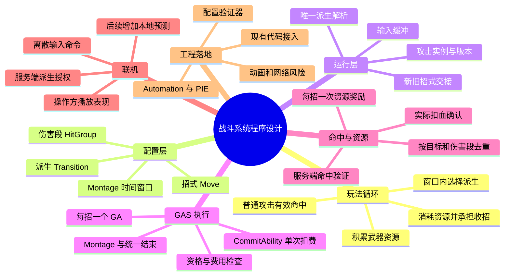
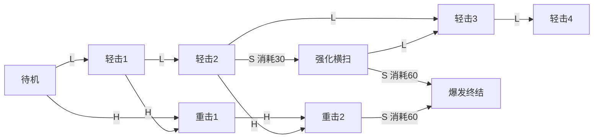
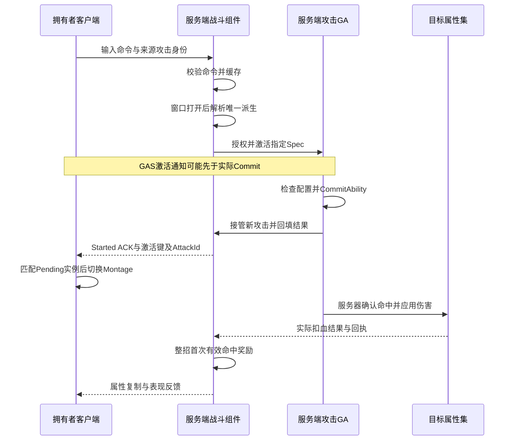

# 怪猎风格战斗系统：详细程序设计

## 总结

本方案在 RPGDeemo 现有战斗系统上增加**招式派生、输入缓冲和独立武器资源**。普通攻击有效命中后积累资源，玩家在指定招式的派生窗口内消耗资源，进入强化横扫或爆发终结等特殊招式。

程序分工固定为：**武器数据资产描述招式和派生关系，HeroCombatComponent 接收输入并选择下一招，攻击 GA 执行单次招式，AttributeSet 保存资源，服务器决定派生、伤害和资源结算。**

第一版先完成一把斧头：四段轻击、两段重击、两个资源派生。每个招式使用一个继承自同一 C++ 攻击基类的轻量 GA 蓝图。后续增加武器主要扩展配置和动画，不再复制一整套攻击流程。

| 决策 | 本方案选择 |
| --- | --- |
| 招式组织 | 每招一次 GA 激活，共用 `UHeroGameplayAbility_AttackBase` |
| 派生判断 | `UHeroCombatComponent` 根据当前招式、输入、窗口和状态确定唯一目标 |
| 配置来源 | `UDataAsset_WeaponCombatDefinition` 保存招式、派生、时间窗口和费用 |
| 武器资源 | 新增 `WeaponGauge / MaxWeaponGauge`，与现有 `CurrentRage` 分开 |
| 资源积累 | 服务器确认正伤害后，按攻击实例最多奖励一次 |
| 费用提交 | `GaugeCost` 是唯一费用数值，通过 GA 的 `CommitAbility()` 扣费一次 |
| 窗口时序 | 数据资产保存 Montage 时间区间，专用 AbilityTask 读取实际动画进度 |
| 联机第一阶段 | `ServerInitiated` GA，服务器执行规则，拥有者客户端执行表现 |
| 最终手感阶段 | 增加 `LocalPredicted`、预测上下文和拒绝校正；不是只修改一个枚举 |

**文档状态：程序设计提案，尚未实施。** 下文新增类型、接口和资产均为待开发内容；代码片段用于说明契约，不是可直接编译的完整补丁。数值为原型初值，不是《怪物猎人》的原版数值。

- 编写日期：2026-11-16。
- 项目：`E:/UEProject/RPGDeemo/RPGDeemo.uproject`。
- 引擎：项目声明 UE 5.6，当前会话确认的编辑器版本为 UE 5.6.1。
- 运行模块：`RPGDeemo`，已有 GAS、Enhanced Input、GameplayTags、Motion Warping 依赖。
- 验证入口：`/Game/Maps/GameModeTestMap`。

## 思维导图

以下代码块可在支持 Mermaid 的 Markdown 预览器中直接显示。



## 目录

1. [目标、范围与现有基础](#1-目标范围与现有基础)
2. [第一版招式与资源规则](#2-第一版招式与资源规则)
3. [模块职责与依赖](#3-模块职责与依赖)
4. [配置数据结构](#4-配置数据结构)
5. [运行时状态与身份](#5-运行时状态与身份)
6. [装备与能力授予](#6-装备与能力授予)
7. [输入缓冲与派生解析](#7-输入缓冲与派生解析)
8. [动画时间轴与窗口](#8-动画时间轴与窗口)
9. [攻击 GA 与安全交接](#9-攻击-ga-与安全交接)
10. [资源属性与扣费](#10-资源属性与扣费)
11. [命中、伤害与资源确认](#11-命中伤害与资源确认)
12. [联机协议与预测升级](#12-联机协议与预测升级)
13. [中断、取消与清理](#13-中断取消与清理)
14. [UI、转向和位移](#14-ui转向和位移)
15. [问题清单与优先级](#15-问题清单与优先级)
16. [涉及文件与资产](#16-涉及文件与资产)
17. [开发顺序与验收](#17-开发顺序与验收)
18. [风险与扩展边界](#18-风险与扩展边界)
19. [参考资料与 UE skills](#19-参考资料与-ue-skills)

## 1. 目标、范围与现有基础

### 1.1 目标

实现“攻击积资源、按当前招式派生、花资源执行特殊招式”的战斗循环。玩家的选择同时受位置、当前动作阶段和资源约束。资源充足并不等于任何时刻都能释放特殊招式。

第一版范围：

- 一把斧头，八个招式。
- 一种独立武器资源，初始为 0，上限为 100。
- 轻击、重击、特殊派生三种攻击意图。
- 伤害、派生、闪避和转向四类窗口。
- 单机、监听服务器和客户端的权威规则。
- 为后续本地预测保留身份、命令与状态协议。

蓄力、空中派生、武器变形、装瓶、多种资源、部位破坏、复杂防反和服务器回溯不属于第一版，但数据结构应允许以后增加。

### 1.2 当前可复用链路

```text
Enhanced Input
→ AWarriorHeroCharacter::Input_AbilityInputPressed
→ UWarriorAbilitySystemComponent::OnAbilityInputPressed
→ TryActivateAbility
→ 攻击 GA / Montage
→ 武器碰撞
→ UHeroCombatComponent::OnHitTargetActor
→ Shared.Event.MeleeHit
→ 伤害 GE / ExecCalc
→ UWarriorAttributeSet::PostGameplayEffectExecute
```

当前代码已有轻重攻击、特殊武器能力、命中事件、局部 HitStop、怒气属性复制和 UI 广播。当前 C++ 输入入口主要直接尝试激活能力，尚无本文描述的统一派生解析器。

依据包括 [ASC 输入处理](E:/UEProject/RPGDeemo/Source/RPGDeemo/Private/AbilitySystem/WarriorAbilitySystemComponent.cpp:49)、[命中入口](E:/UEProject/RPGDeemo/Source/RPGDeemo/Private/Component/Combat/HeroCombatComponent.cpp:69) 和 [现有武器数据](E:/UEProject/RPGDeemo/Source/RPGDeemo/Public/WarriorTypes/WarriorStructTypes.h:38)。

本次对照了源码和资产路径，未逐节点读取全部攻击蓝图。因此“伤害是否已经完整收口到服务器”和“蓝图内部是否已有局部缓存”等内容仍需实施前确认，不能仅凭 C++ 入口断言。

## 2. 第一版招式与资源规则

### 2.1 输入和招式表

| 意图 | 标记 | 说明 |
| --- | --- | --- |
| 轻攻击 | `Combat.Input.Light` | 较快、积累资源、连接其他招式 |
| 重攻击 | `Combat.Input.Heavy` | 承诺更高，提供伤害或硬直收益 |
| 特殊派生 | `Combat.Input.Special` | 指定节点、指定窗口内消耗资源 |

| MoveId 后缀 | 费用 | 首次有效命中奖励 | 可进入的主要招式 |
| --- | ---: | ---: | --- |
| `Axe.Light1` | 0 | 10 | Light2、Heavy1 |
| `Axe.Light2` | 0 | 10 | Light3、Heavy2、Sweep |
| `Axe.Light3` | 0 | 15 | Light4 |
| `Axe.Light4` | 0 | 20 | 正常收招 |
| `Axe.Heavy1` | 0 | 15 | Heavy2 |
| `Axe.Heavy2` | 0 | 20 | Finisher |
| `Axe.Sweep` | 30 | 0 | Light3、Finisher |
| `Axe.Finisher` | 60 | 0 | 正常收招 |

完整 MoveId 使用 `Combat.Move.Axe.Light1` 等形式。`Combat.Move.Idle` 是虚拟起点，不需要实际 GA 或 Montage。



强化横扫用于范围进攻和继续连接；爆发终结用于惩罚敌人大破绽，前摇、收招更长。Sweep 接 Finisher 总消耗 90，二者都不返还攻击资源。

### 2.2 固定资源政策

- 普通招式只有服务器确认造成正伤害后才奖励资源。
- 一招同时命中多个敌人，伤害可以分别结算，资源只奖励一次。
- 多段攻击可以造成多段伤害，第一版仍遵守整招一次资源奖励。
- 空挥、友军、尸体、无敌目标、完全挡住且未扣血的命中不奖励。
- 输入特殊招式时不扣费，真正提交该招式时扣费。
- 成功启动后的空挥、受击或主动取消不退款。
- 配置或动画启动故障可走专用补偿流程，见第 9 节。
- 死亡、重开、切换武器清零，暂不做自然衰减。
- 资源不足时返回明确失败结果，不自动换成普通招式。

## 3. 模块职责与依赖

| 模块 | 权威职责 | 客户端职责 |
| --- | --- | --- |
| 战斗数据资产 | 提供规则、招式和参数 | 提供表现和预览所需配置 |
| `UHeroCombatComponent` | 缓冲命令、解析派生、授权启动、保存攻击记录、验证命中 | 采集输入、保存表现状态、处理结果反馈 |
| `UHeroGameplayAbility_AttackBase` | 校验授权、提交费用、执行招式、结束清理 | 第一阶段播放本地动作和表现 |
| `UWarriorAttributeSet` | 保存资源、裁剪范围、报告实际伤害 | 复制通知和属性观察 |
| `UHeroUIComponent` | 不决定战斗结果 | 广播资源、派生提示和失败原因 |

建议依赖关系：

```text
WarriorCombatTypes.h
    ↑                ↑
CombatDefinition   AttackBase
    ↑                ↑
       HeroCombatComponent
               ↑
         HeroCharacter
```

`WarriorCombatTypes.h` 只包含必要基础头和前置声明。不要让它引用现有 `WarriorStructTypes.h`、HeroCharacter、CombatComponent 或 `WarriorHeroGameplayAbility.h`。

`FWarriorHeroWeaponData` 只前置声明 `UDataAsset_WeaponCombatDefinition` 并保存引用。字段中的 `TSubclassOf<UGameplayAbility>` 是否实际派生自 AttackBase，由配置验证器检查。

## 4. 配置数据结构

以下结构省略反射宏和导出宏。真正实现时，编辑字段应补齐 `USTRUCT(BlueprintType)`、`UPROPERTY(EditDefaultsOnly, BlueprintReadOnly)` 等，并保持 `.generated.h` 为最后一个包含头。

```cpp
enum class EWarriorCombatWindowType : uint8
{
    Damage,
    Branch,
    Dodge,
    Turn
};

struct FWarriorCombatWindowDefinition
{
    FGameplayTag WindowId;
    EWarriorCombatWindowType Type = EWarriorCombatWindowType::Branch;

    // Montage 绝对时间，区间采用 [BeginTime, EndTime)。
    float BeginTime = 0.f;
    float EndTime = 0.f;

    uint16 HitGroupId = 0; // 仅 Damage 窗口使用。
};

struct FWarriorCombatHitGroupDefinition
{
    uint16 HitGroupId = 0;
    float DamageMultiplier = 1.f;
};

struct FWarriorCombatMoveDefinition
{
    FGameplayTag MoveId;
    TSubclassOf<UGameplayAbility> AbilityClass;
    TObjectPtr<UAnimMontage> Montage = nullptr;

    float PlayRate = 1.f;
    float DamageMultiplier = 1.f;
    float GaugeCost = 0.f;
    float GaugeGainOnFirstHit = 0.f;

    TArray<FWarriorCombatWindowDefinition> Windows;
    TArray<FWarriorCombatHitGroupDefinition> HitGroups;
};

struct FWarriorCombatTransitionDefinition
{
    FName TransitionId;

    FGameplayTag SourceMoveId;
    FGameplayTag InputTag;
    FGameplayTag RequiredWindow;
    FGameplayTag TargetMoveId;

    int32 Priority = 0;
    FGameplayTagContainer RequiredTags;
    FGameplayTagContainer BlockedTags;
    bool bRequireConfirmedHit = false;
};
```

### 4.1 唯一数据来源

- `MoveId` 是稳定身份，不用数组下标作为持久或网络身份。
- GA 子类 CDO 只指定不可变 `MoveId`；动画、伤害、窗口和费用都从当前武器 Definition 查询。
- `GaugeCost` 是唯一费用数值，不在 Transition 或 GA 蓝图再填写另一份 30/60。
- Transition 保存“从哪一招、按什么、什么窗口、到哪一招”。
- 第一版每招一个完整 Montage，不使用跳转 Section、循环和倒放。
- 同一 GA 类第一版只对应一个 MoveId，避免共享 InstancedPerActor 实例的重入歧义。

### 4.2 数据资产接口

```cpp
const FWarriorCombatMoveDefinition* FindMove(FGameplayTag MoveId) const;

void FindTransitions(
    FGameplayTag SourceMoveId,
    FGameplayTag InputTag,
    TArray<const FWarriorCombatTransitionDefinition*>& OutTransitions) const;

virtual EDataValidationResult IsDataValid(
    FDataValidationContext& Context) const override;
```

编辑使用 `TArray`；装备后构建只读的 `MoveId → Index` 和 `SourceMoveId → TransitionIndices` 缓存。缓存仅加速查找，不复制一套可独立修改的参数。

### 4.3 配置验证条件

- MoveId、TransitionId 唯一且有效，派生起点和终点存在；Idle 是明确例外。
- AbilityClass 派生 AttackBase，其 CDO MoveId 与配置一致。
- Montage 存在、骨架兼容、PlayRate 为有限正数。
- 窗口满足 `0 <= BeginTime < EndTime <= MontageLength`。
- WindowId 在招式内唯一；Damage 窗口引用有效 HitGroup。
- Transition 的 RequiredWindow 属于 SourceMove，且为 Branch 窗口；Idle 起始边无需窗口。
- 所有费用、奖励和倍率均为有限非负数。
- 同输入、同源招式、同优先级的可重叠条件报告歧义，不依赖数组顺序。
- 检查不可达节点。允许设计明确的循环，但禁止无需新输入的零时长自动循环。
- 特殊招式奖励为 0，第一版禁止派生到仍在执行的同一 GA。

## 5. 运行时状态与身份

### 5.1 攻击身份

```cpp
struct FWarriorAttackHandle
{
    uint32 EquipmentRevision = 0;
    uint32 AttackId = 0;
};
```

完整身份还隐含所属 Pawn/CombatComponent。同一 Pawn 上 AttackId 单调增加，0 保留无效值。装备、卸下、死亡重置增加 EquipmentRevision，拒绝旧武器命令和旧回执。新 Pawn 是新的身份域。

实现相等比较与哈希时同时考虑两个字段。若使用有限整数，序号比较应有回绕政策；不得通过转换为 float 传输身份。

### 5.2 每次攻击记录

```cpp
struct FWarriorAttackRuntime
{
    FWarriorAttackHandle Handle;
    FGameplayTag MoveId;
    TWeakObjectPtr<UGameplayAbility> Ability;

    uint32 TriggerInputSequence = 0;
    float GaugeGainSnapshot = 0.f;
    float ActualGaugeCost = 0.f;

    bool bAcceptNewHits = false;
    bool bGaugeRewardGranted = false;
    bool bStartupRefunded = false;

    TSet<FGameplayTag> ActiveWindows;
    TMap<uint16, TSet<TWeakObjectPtr<AActor>>> HitTargets;
    // 另保存服务器已签发命中回执及其消费状态。
};
```

组件还保存 CurrentAttack、BufferedInput、PendingTransition、NextAttackId、EquipmentRevision、StateRevision 和 `bTransitionInProgress`。当前攻击指针与历史攻击记录分开，旧回调不能通过“当前招式”推断旧攻击身份。

`GaugeGainSnapshot` 在出招时保存。伤害回执到达时读取对应攻击记录，不读取已经切换的 CurrentMove。

### 5.3 生命周期政策

第一版伤害 GE 使用同步 Instant 结算，接受命中与实际扣血应在统一调用链完成。攻击结束后立即停止接受新命中。

未来增加异步伤害时，只保留已签发回执所需的短期记录，并设置 TTL 和容量上限；目标使用弱引用。结束记录只能完成已接受的命中，不允许重新接受任意旧攻击命中。死亡、换武器后旧版本回执不给新武器增加资源。

## 6. 装备与能力授予

在现有 `FWarriorHeroWeaponData` 中增加：

```cpp
UPROPERTY(EditDefaultsOnly, BlueprintReadOnly)
TObjectPtr<UDataAsset_WeaponCombatDefinition> CombatDefinition;
```

服务器装备流程：

```text
结束旧攻击和输入
→ EquipmentRevision++
→ 移除旧战斗招式能力
→ 持有并验证新 Definition
→ 加载本武器所需 Montage / GA
→ 建立配置缓存
→ 授予所有招式能力
→ 保存 MoveId → SpecHandle
→ 重置资源
→ 发布装备就绪状态
```

建议接口：

```cpp
void GrantCombatMoves(
    UDataAsset_WeaponCombatDefinition* Definition,
    int32 AbilityLevel);

void RemoveCombatMoves();

FGameplayAbilitySpecHandle FindMoveAbilityHandle(FGameplayTag MoveId) const;
```

授予示意：

```cpp
FGameplayAbilitySpec Spec(Move.AbilityClass, AbilityLevel);
Spec.SourceObject = Definition;

const FGameplayAbilitySpecHandle Handle = ASC->GiveAbility(Spec);
MoveAbilityHandles.Add(Move.MoveId, Handle);
```

`SourceObject = Definition` 仅用于新的战斗招式授予路径，不批量改变旧装备、交互或锁定 GA 的来源语义。SourceObject 是弱引用，组件或武器必须通过 `UPROPERTY` 持有 Definition。

拥有者客户端必须在可攻击前拿到已装备配置身份、所需资源和复制来的 AbilitySpec。定义未就绪时暂存或拒绝输入并提供结果，不能在派生窗口里同步读盘。

新招式不再全部绑定到相同 InputTag。原 ASC 会遍历匹配能力并尝试激活；派生必须先选定唯一 MoveId，再按准确 SpecHandle 激活。

## 7. 输入缓冲与派生解析

### 7.1 接管现有输入

保留 IA、IMC 和原始 InputTag，在路由入口归一化为 Light、Heavy、Special。装备、锁定、交互等非战斗输入继续使用原路径。

```cpp
void AWarriorHeroCharacter::Input_AbilityInputPressed(FGameplayTag InInputTag)
{
    if (HeroCombatComponent->TryHandleCombatInput(
        InInputTag, EWarriorCombatInputEvent::Pressed))
    {
        return;
    }

    WarriorAbilitySystemComponent->OnAbilityInputPressed(InInputTag);
}
```

`TryHandleCombatInput()` 返回“该按键已由战斗系统接管”，不是“攻击成功”。即使资源不足，也不能退回原 ASC 再尝试一次旧攻击。

输入命令：

```cpp
enum class EWarriorCombatInputEvent : uint8
{
    Pressed,
    Released,
    Canceled
};

struct FWarriorCombatInputCommand
{
    uint32 InputSequence = 0;
    uint32 EquipmentRevision = 0;
    uint32 SourceAttackId = 0;

    FGameplayTag InputTag;
    EWarriorCombatInputEvent Event = EWarriorCombatInputEvent::Pressed;
};
```

第一版只由 Pressed 触发派生。Released 和 Canceled 用于维护按住状态，并为蓄力扩展保留契约。当前输入绑定的 Started / Completed 之外应补 Canceled，防止切换输入上下文后残留按住状态。

### 7.2 缓冲政策

- 最多一个待执行攻击输入，新攻击输入覆盖旧输入。
- 默认有效期 0.2 秒，客户端本地缓冲与服务器缓冲分别计时。
- 服务器从收到命令起计时，客户端不能通过自报时间任意延长窗口。
- HitStop 期间暂停缓冲过期，普通暂停也停止处理；用明确定义的战斗缓冲时钟实现。
- 输入和 SourceAttackId 绑定，不自动把旧招式的输入移交给下一招。
- 同一 InputSequence 只能执行一次，合法失败也要标记处理结果，防止重试重复扣费。
- 资源不足的特殊输入立即失败并清除，不无限等待后续回能。

### 7.3 解析接口与顺序

```cpp
bool TryHandleCombatInput(
    FGameplayTag RawInputTag,
    EWarriorCombatInputEvent Event);

void QueueCombatInput(const FWarriorCombatInputCommand& Command);

EWarriorCombatResolveResult ResolveTransition(
    const FWarriorCombatInputCommand& Command,
    FName& OutTransitionId) const;

void TryConsumeBufferedInput();
```

ResolveTransition 按以下顺序检查：

1. Pawn、武器、ASC 和配置是否就绪，是否存活。
2. EquipmentRevision、InputSequence 和 SourceAttackId 是否有效。
3. 输入是否属于当前武器允许的攻击意图。
4. 查询 CurrentMoveId + InputTag 的候选边。
5. 检查 RequiredTags / BlockedTags 和要求命中的条件。
6. 检查派生窗口；未来尚有合法窗口则缓存，已错过则拒绝。
7. 检查目标 GA 资格和资源。
8. 按 Priority 得到唯一结果；存在歧义则报告配置错误。

重新尝试缓冲的时机限定为输入到达、Branch 窗口打开，以及相关资格变化。不扫描全部角色的所有招式；执行之前仍要完整重验。

结果至少包含 Buffered、Started、NoTransition、WindowExpired、InsufficientGauge、BlockedByState、StaleAttack、StaleEquipment、StartupFailed。每个结果都可用于日志与 UI，但 UI 不决定成功与否。

## 8. 动画时间轴与窗口

### 8.1 唯一计时来源

数据资产中的窗口区间是玩法唯一真源。新增 `UAbilityTask_WarriorCombatTimeline`，在攻击 GA 活跃期间读取实际 MontagePosition，处理伤害、派生、闪避和转向窗口。

示例招式总长约 1 秒：

| 区间 | 时间 | 行为 |
| --- | --- | --- |
| 前摇 | 0.00–0.25 | 准备动作 |
| 伤害有效段 | 0.25–0.45 | 允许命中 |
| 收招 | 0.45–1.00 | 等待结束或合法派生 |
| Branch | 0.55–0.80 | 允许攻击派生 |
| Dodge | 0.65–1.00 | 允许翻滚取消 |
| Turn | 0.00–0.15 | 允许有限转向 |

窗口允许重叠，不能只用一个 Startup/Active/Recovery 枚举代替全部资格。窗口跟随动画位置，因此攻速变化无需重写世界 Timer。

### 8.2 Timeline Task

Task 保存自身 AttackHandle、Montage 身份、运行时 MontageInstanceId 和 PreviousPosition。MontageInstanceId 只用于本机回调隔离，不作为跨机器共同身份。

每帧处理顺序：

```text
验证 Ability / AttackHandle / MontageInstance
→ 读取 CurrentPosition
→ 按时间顺序处理 PreviousPosition 到 CurrentPosition 跨越的边界
→ 对经过的伤害窗口执行必要采样
→ 打开 Branch 时尝试消费输入
→ 保存 CurrentPosition
```

若同一帧同时跨过 Begin 和 End，也要处理该区间，不能只判断当前位置是否在窗内。第一版不支持主动倒放或循环；发生异常跳转时关闭该实例窗口，进入明确结束或恢复路径。

组件接口始终带身份：

```cpp
void OpenWindow(FWarriorAttackHandle Attack, FGameplayTag WindowId);
void CloseWindow(FWarriorAttackHandle Attack, FGameplayTag WindowId);
```

### 8.3 与现有 Notify 的迁移

迁移后的 Montage 停用旧 `ANS_ToggleWeaponCollision` 的玩法控制，防止两套逻辑同时开关伤害。音效、拖尾等表现 Notify 可继续使用。

如果以后使用 NotifyState 编辑窗口，应把它作为导出数据的编辑来源，避免运行时又维护一份独立起止时间。Notify 对象可能被多个角色共享，不能保存当前角色、AttackId 或命中列表。

### 8.4 命中采样限制

当前 Box Overlap 可作为第一版候选来源，但开窗时必须主动查询已重叠目标。单帧开启再关闭碰撞，不保证引擎恰好派发 BeginOverlap。

主动查询当前姿态也不等于解决高速挥击：武器可能从敌人一侧直接移动到另一侧。高速招式需要保存前后 Socket 位置并做 Sweep，必要时增加子采样。新攻击和传送必须重置历史位置，避免跨越整张地图扫描。

Timeline 与命中采样应在骨骼姿态更新后读取武器位置；专用服务器需要验证动画 Tick 和骨骼更新策略。

## 9. 攻击 GA 与安全交接

### 9.1 攻击基类

新增 `UHeroGameplayAbility_AttackBase`，继承现有 `UWarriorHeroGameplayAbility`。第一阶段设置：

```cpp
InstancingPolicy = EGameplayAbilityInstancingPolicy::InstancedPerActor;
NetExecutionPolicy = EGameplayAbilityNetExecutionPolicy::ServerInitiated;
NetSecurityPolicy = EGameplayAbilityNetSecurityPolicy::ServerOnly;
```

CDO 只保存 MoveId；每次激活重新初始化 MyAttackHandle、Task、委托句柄和结束标记。

需要实现或覆写：

```text
CanActivateAbility
ActivateAbility
CheckCost
ApplyCost
EndAbility
FinishForCombo
OnMontageCompleted / Interrupted / Cancelled
```

CanActivateAbility 检查父类条件、当前配置、MoveId、Spec 来源、启动授权、禁止状态和费用。不要把 `State.Attacking` 简单设为所有攻击的阻挡标签，否则正在攻击时合法下一招也会被阻挡。攻击互斥由组件的授权与交接控制。

第一阶段的服务器 ActivateAbility 执行规则和费用；拥有者客户端分支只负责表现，不 Commit、不奖励资源、不改权威状态。客户端进入 ActivateAbility 时先注册 Pending 表现实例，等待第 12 节中匹配的 Started ACK，再切换 Montage；不能在 GAS 激活通知刚到时就打断旧攻击表现。客户端自然播放结束也不能擅自结束服务器实例。

### 9.2 派生启动授权

```cpp
enum class EWarriorCombatTransitionOutcome : uint8
{
    Pending,
    Committed,
    Failed
};

struct FWarriorCombatTransitionTicket
{
    uint32 InputSequence = 0;
    FWarriorAttackHandle SourceAttack;
    FWarriorAttackHandle ReservedAttack;

    FGameplayTag TargetMoveId;
    FGameplayAbilitySpecHandle TargetAbility;
    EWarriorCombatTransitionOutcome Outcome =
        EWarriorCombatTransitionOutcome::Pending;
};
```

Ticket 只由服务器创建，保存在组件短期上下文中。客户端不能自行构造一个 Ticket 作为授权。

### 9.3 新旧招式交接顺序

```text
解析合法派生
→ bTransitionInProgress = true
→ 创建 Ticket，预留新 AttackId
→ TryActivateAbility(TargetSpecHandle, false)
→ 新 GA 检查 Ticket、配置和费用
→ CommitAbility
    失败：新 GA 结束，旧攻击继续
    成功：旧伤害窗关闭，建立新攻击，旧 GA 结束，播放新 Montage
→ 新 GA 回填 Outcome
→ 组件发送实际结果并清 Ticket
→ bTransitionInProgress = false
```

`Outcome = Committed` 的成功边界为费用已提交且服务端本次 Montage 已成功启动，此时才发送 Started ACK。仅 Commit 成功但动画启动失败时，结果仍为 StartupFailed，并按下一节补偿实际扣费。

不能先结束旧 GA 再尝试新招式，否则资源不足时连旧收招状态也丢失。正常交接用项目方法 `FinishForCombo()` 在合法授权下结束旧 GA，不完全依赖受 CanBeCanceled 限制的 CancelAbility。

`TryActivateAbility() == true` 只说明进入激活流程，不保证 Commit 或动画播放成功，必须读取明确 Outcome。

旧 EndAbility 可能因 GAS ScopeLock 延迟。旧 GA 可以销毁自己的 Task，但共享状态清理必须按 AttackHandle，不能关掉新招式的碰撞或删除新 Warp Target。引擎 PlayMontageAndWait 的停止逻辑也会检查当前 AnimatingAbility 与 Montage，项目自写逻辑应保持相同的所有权约束。

### 9.4 动画与 Task

使用 `UAbilityTask_PlayMontageAndWait::CreatePlayMontageAndWaitProxy()`，先绑定完成、取消、中断回调，再 `ReadyForActivation()`。Timeline 只在成功建立本次动画实例后工作。

Commit 前检查 Montage、AnimInstance、武器和配置，降低启动失败概率。最终播放失败时：

1. 标记该次启动故障，阻止后续伤害。
2. 服务器补偿本次实际扣费，最多一次，受资源上限约束。
3. 进入 Idle / Failed，清理新攻击；不尝试复活已结束的旧 Montage。
4. 发送失败状态，让客户端停止本次表现。

正常受击中断或空挥不退款。GA 的 Instant Cost 不会因为 EndAbility 自动返还。

## 10. 资源属性与扣费

### 10.1 独立属性

```cpp
UPROPERTY(BlueprintReadOnly, ReplicatedUsing = OnRep_WeaponGauge)
FGameplayAttributeData WeaponGauge;
ATTRIBUTE_ACCESSORS(UWarriorAttributeSet, WeaponGauge)

UPROPERTY(BlueprintReadOnly, ReplicatedUsing = OnRep_MaxWeaponGauge)
FGameplayAttributeData MaxWeaponGauge;
ATTRIBUTE_ACCESSORS(UWarriorAttributeSet, MaxWeaponGauge)
```

初始值分别为 0 和 100。实现 OnRep、GetLifetimeReplicatedProps、PreAttributeChange 与 PostGameplayEffectExecute。复制使用 `DOREPLIFETIME_CONDITION_NOTIFY`、`REPNOTIFY_Always` 和 `GAMEPLAYATTRIBUTE_REPNOTIFY`。

约束为 `MaxWeaponGauge >= 1`、`0 <= WeaponGauge <= MaxWeaponGauge`。最大值变化后重新裁剪当前值。基线可沿用当前属性 COND_None 的复制方式，后续确认只有拥有者需要该值时再调整条件。

### 10.2 一个公共资源 GE

```text
GE_Combat_ChangeWeaponGauge
DurationPolicy = Instant
Attribute = WeaponGauge
Operation = Add
Magnitude = SetByCaller(Data.Combat.GaugeDelta)
```

新增招式的 GaugeCost 是费用唯一真源。使用动态费用时必须覆写 CheckCost 与 ApplyCost：

- CheckCost：父类检查通过后，从本招式配置读取费用，判断当前 WeaponGauge 是否足够。
- ApplyCost：父类费用为空或按明确规则组合，构造公共 GE Spec，把 GaugeDelta 设为 `-GaugeCost`，应用到自身。
- CommitAbility：调用这条费用路径，仅提交一次。
- 普通招式费用为 0，不构造扣费 GE。

默认 CommitAbility 不会自动读取自定义 GaugeCost 或替你填 SetByCaller。攻击基类不再额外配置另一份 Cost GE 费用，组件不手减、Notify 不扣费。

资源获得使用同一个公共 GE，GaugeDelta 为正；只有服务器确认命中后调用。退款也通过受控 GE，但必须带已处理标记，不能与正常奖励混用。

## 11. 命中、伤害与资源确认

### 11.1 统一服务器命中链

```text
武器给出候选目标
→ TryAcceptHit
→ 验证当前攻击、Damage 窗口、目标、阵营和命中组
→ 记录命中占位并签发回执
→ 构造伤害 GE Spec
→ ExecCalc
→ 目标 AttributeSet 扣血
→ 生成 DamageResult
→ 攻击者 ConfirmDamage
→ 第一次正伤害奖励资源
```

必须在应用 GE 之前登记去重，避免 GE 回调重入再次接受相同命中。被挡住或免疫的一次接触也消费本伤害段的目标名额，避免在同一挥击窗口持续重试。

接口契约：

```cpp
bool TryAcceptHit(
    FWarriorAttackHandle Attack,
    uint16 HitGroupId,
    const FHitResult& Hit,
    FWarriorCombatHitReceipt& OutReceipt);

void ConfirmDamage(const FWarriorCombatDamageResult& Result);
```

### 11.2 两套去重粒度

| 用途 | 去重键 | 清理时机 |
| --- | --- | --- |
| 伤害 | 攻击者 + AttackHandle + HitGroupId + TargetActor | 该攻击结束 |
| 资源奖励 | 攻击者 + AttackHandle | 该攻击记录结束 |
| 回执 | AttackHandle + ReceiptId | 处理一次后标记已消费 |

同一招的两个窗口共用 HitGroupId 时，同目标只伤害一次；真正两段攻击使用两个 HitGroupId。窗口关闭只关闭采样，不清整招 HitTargets。

### 11.3 伤害 Context 与回执

```cpp
struct FWarriorCombatEffectContext : FGameplayEffectContext
{
    FWarriorAttackHandle Attack;
    uint16 HitGroupId = 0;
    uint32 ReceiptId = 0;
};
```

实现 GetScriptStruct、Duplicate、NetSerialize 和 TStructOpsTypeTraits。Duplicate 要正确复制基础 Context 和 HitResult 等拥有的数据，不能只浅拷贝自定义字段。

新增 `UWarriorAbilitySystemGlobals::AllocGameplayEffectContext()` 分配该 Context；通过 UE 5.6 的 Gameplay Abilities 项目设置配置 Globals Class。对应配置应写入 `DefaultGame.ini` 的 GameplayAbilitiesDeveloperSettings，而不是仅凭旧版本教程修改过时字段。需要重启编辑器。

Context 中的 ID 是整数。不能通过 float 的 SetByCaller 或 EventMagnitude 传整数身份，大于 `2^24` 后会丢失逐个整数精度。伤害值、倍率等数值仍可使用 SetByCaller。

### 11.4 实际伤害确认

在目标 AttributeSet 的 DamageTaken 分支中：

```cpp
const float OldHealth = GetCurrentHealth();
const float Damage = FMath::Max(0.f, GetDamageTaken());
SetDamageTaken(0.f);

const float NewHealth = FMath::Clamp(OldHealth - Damage, 0.f, GetMaxHealth());
SetCurrentHealth(NewHealth);

const float ActualHealthLoss = FMath::Max(0.f, OldHealth - NewHealth);
```

读取经过验证的战斗 Context，用 `GetOriginalInstigatorAbilitySystemComponent()` 定位攻击来源，报告包含 AttackHandle、ReceiptId、目标与 ActualHealthLoss 的结果。非本文攻击 Context 的伤害继续走普通扣血，但不参与武器资源奖励。

ConfirmDamage 验证回执确实由自己签发、未消费、版本仍有效，且实际扣血大于 0。先设置 `bGaugeRewardGranted`，再应用奖励 GE，避免奖励回调重入。

Instant GE 应同步完成。已签发回执的未来异步结算按第 5 节处理，不允许旧武器的结果给新武器回能。

### 11.5 明确招式伤害倍率

新攻击路径逐步替代旧 LightComboCount / HeavyComboCount 增伤：

```text
FinalDamage =
    Max(0, WeaponBaseDamage + AttackPower)
    × MoveDamageMultiplier
    × HitGroupDamageMultiplier
    ÷ Max(1, DefensePower)
```

这是保留当前公式形状的原型选择，不代表最终平衡公式。输入和输出都应检查有限值；旧攻击的段数增伤不能在新倍率后再次叠加。

## 12. 联机协议与预测升级

### 12.1 第一阶段角色分工

| 执行端 | 行为 |
| --- | --- |
| 服务器 | 收命令、选择派生、提交费用、播放权威 Montage、检测命中与结算 |
| 拥有者客户端 | 输入、缓冲、执行 ServerInitiated GA 的表现分支、显示结果 |
| 其他客户端 | 接收 ASC Montage 复制和 GameplayCue |

`NetExecutionPolicy::ServerInitiated` 与 `NetSecurityPolicy::ServerOnly` 是不同配置：前者让服务器启动并通知拥有者执行 GA，后者禁止客户端绕过组件直接请求启动、结束或取消该 GA。

不能改为 ServerOnly 执行后只依赖 Montage 复制。UE 5.6 的 `OnRep_ReplicatedAnimMontage()` 会跳过本地控制角色，拥有者不会因此自动播放攻击。

### 12.2 RPC 与状态

```cpp
UFUNCTION(Server, Reliable)
void ServerSubmitCombatInput(const FWarriorCombatInputCommand& Command);

UFUNCTION(Client, Reliable)
void ClientCombatInputResult(
    uint32 InputSequence,
    EWarriorCombatInputResult Result,
    const FWarriorCombatNetState& State);

UFUNCTION(Client, Reliable)
void ClientCombatAttackStarted(const FWarriorCombatStartAck& Ack);
```

`UHeroCombatComponent` 需要启用复制，所属 Pawn 必须由发送客户端拥有。只对 Started / Completed / Canceled 等离散事件发消息，不在每帧发送 Reliable RPC；服务器验证输入频率，避免异常重复请求堆积。

状态至少包含：

```cpp
struct FWarriorCombatNetState
{
    uint32 StateRevision = 0;
    uint32 EquipmentRevision = 0;
    uint32 AttackId = 0;
    uint32 LastConsumedInputSequence = 0;
    FGameplayTag CurrentMoveId;
    double ServerStartTime = 0.0;
    // 另有 Idle / Starting / Attacking / Interrupted 等状态。
};
```

通过 ReplicatedUsing 和结果 RPC 提供拥有者所需状态。StateRevision 单调增加，只过滤项目战斗状态和 ACK，旧版本不能覆盖新版本。WeaponGauge 仍以 GAS 属性复制及其 OnRep 为准，不能用项目 StateRevision 拒收属性复制，也不把 ACK 内的估算资源回写 AttributeSet。ServerStartTime 只能作为表现同步参考，不能代替服务器实际动画窗口。

成功启动专用 ACK：

```cpp
struct FWarriorCombatStartAck
{
    uint32 InputSequence = 0;
    FGameplayAbilitySpecHandle SpecHandle;
    FPredictionKey ActivationPredictionKey;
    FWarriorCombatNetState State;
};
```

Started 只通过 ClientCombatAttackStarted 发送；Buffered 和失败通过 ClientCombatInputResult 发送，不再为同一次成功启动发送第二份 Started。SpecHandle 和 ActivationPredictionKey 来自本次服务端 GA 激活，拥有者使用 `GetCurrentActivationInfo().GetActivationPredictionKey()` 与 SpecHandle 配对 Pending 表现实例，ACK 中的 State 提供 AttackHandle 与 MoveId。

GAS 激活通知、项目 ACK 和属性复制不假设跨对象的到达顺序。ACK 与 Pending 实例任意一方先到时，先存入短期且有容量上限的缓存；两者匹配、实例仍活跃且 StateRevision 有效时才播放新 Montage，并清理旧表现。失败、远端结束、死亡、换武器和超时均清除相应 Pending；保留短期失效记录，防止晚到 ACK 重启动作。PredictionKey 是短期激活配对键，不代替完整 AttackHandle，也不作为长期唯一 ID。

客户端只发送输入和来源身份，不发送伤害、费用、资源奖励或任意 AbilityClass。服务器从自己的已装备 Definition 与 MoveId→SpecHandle 映射决定目标。

### 12.3 一次派生的网络时序



GAS 的激活成功通知在服务端 ActivateAbility / Commit 前就可能发出，不能作为扣费成功 ACK。拥有者此时只建立 Pending；Commit 或动画启动失败时销毁本次 Pending，不破坏仍合法的旧攻击表现。服务端已经结束的实例不能因晚到 ACK 再播放。

如果拥有者已开始表现却尚未得到新 AttackId，下一次输入先本地保留，等待本次提交结果后归属到相应实例。超过本地 TTL 则丢弃，不能拿旧 SourceAttackId 发送，也不能任意归属给后来出现的另一招。

### 12.4 服务器复验

服务器收到命令后检查 Pawn、ASC、装备版本、新序号、来源攻击、输入白名单和派生资格。未到窗但可等待时缓存，执行前再检查状态与资源。客户端时间戳不直接决定资格，第一版不做回溯开窗。

Listen Host 直接调用同一权威命令处理函数；不要因本地有权限而另走一套派生规则。

### 12.5 本地预测是独立开发阶段

ServerInitiated 基线具有客户端往返延迟，不能直接作为怪猎式最终手感验收结果。Root Motion 和 Motion Warping 在拥有者播放滞后时也可能出现移动校正；第一阶段先使用短位移招式验证规则。

升级步骤：

1. 招式 GA 改为 LocalPredicted，调整 NetSecurityPolicy 允许客户端发起。
2. 精确激活目标 Spec，并把 InputSequence、SourceAttackId、EquipmentRevision 关联到 PredictionKey。
3. 用 GAS EventData / TargetData 或明确协议传请求上下文，服务器仍重验全部条件。
4. 客户端预测动作和支持预测的费用 GE；资源命中奖励仍先由服务器确认。
5. 服务器拒绝后取消对应预测实例、回正费用和招式状态。
6. 设计旧招式恢复政策：预测结束旧 GA 后，GAS 不会自动将它复活。

可使用的真实 GAS API 包括 CallServerSetReplicatedTargetData、AbilityTargetDataSetDelegate、ConsumeClientReplicatedTargetData 和 FScopedPredictionWindow。TargetData 要与本次 AbilitySpecHandle、PredictionKey 对应并消费，不能复用旧激活的数据。

普通 TryActivateAbility 不自动携带项目字段；SendGameplayEventToActor 只是本地事件派发。不能通过切换枚举就宣称完成网络预测。

## 13. 中断、取消与清理

```cpp
void EndAttack(
    FWarriorAttackHandle Attack,
    EWarriorCombatEndReason Reason);

void ResetCombatContext(EWarriorCombatResetReason Reason);
```

EndReason 至少有 Completed、ComboTransition、Dodge、HitReact、Death、Unequip、StartupFailed。Reset 用于整个角色战斗上下文失效；正常派生只结束旧攻击，不能全量 Reset。

清理顺序：

1. 标记该实例不再接受新命中。
2. 关闭该实例所有窗口与采样。
3. 结束该实例 Task，解绑其委托。
4. 清理该实例 Warp Target、转向和临时状态。
5. 清理或短期保留已签发回执所需记录。
6. 按原因处理缓冲；受击、死亡、换武器清除待执行输入。
7. 仅当它仍是 CurrentAttack 时清当前指针。

EndAttack 必须幂等。重复 End、晚到 Notify、旧 Montage 回调不能关掉新招式。

共享临时状态不能通过“设置回默认值”盲目恢复。武器碰撞、移动速度、转向权限、HitStop 和 Warp Target 都要确认所属攻击或所属系统，避免旧实例覆盖新实例设置。

当前 HitStop 使用多个恢复 Timer，后一次顿帧可能被前一次 Timer 提前恢复。建议改为一个可刷新截止时间的角色级 HitStop 管理，且退出时恢复原始时间倍率，而非假设原值永远为 1。

## 14. UI、转向和位移

### 14.1 UI 只观察

`UHeroUIComponent` 新增：

```text
OnWeaponGaugeChanged(Current, Max)
OnAvailableCombatTransitionsChanged(展示用派生列表)
OnCombatInputFailed(InputSequence, Reason)
BroadcastCurrentWeaponGaugeState()
```

Widget 绑定后主动读取一次当前值，随后监听变化。不通过 Widget Tick 轮询，也不根据进度条百分比决定是否能释放。

派生提示来源于本地已知配置和状态，仅作预览；费用最终由服务器读取 AttributeSet 检查。输入失败可显示短促提示，避免每个重复按键弹出模态窗口。

### 14.2 转向与位移

Turn 窗口内允许有限转向，窗口外保持出招方向，避免整段攻击随镜头瞬间旋转。后续在招式配置增加 MaxTurnAngle / TurnSpeed，按攻击实例恢复原移动设置。

Motion Warping 只对少数突进或终结招使用，限制修正距离和角度。目标失效时按既定方向播放或失败，不瞬移追踪。

Root Motion 交给 CharacterMovement / GAS 动画流程，避免在攻击期间每帧 SetActorLocation 与其冲突。所有 Warp Target 都有攻击所有权，旧 End 不移除新目标。

## 15. 问题清单与优先级

| 优先级 | 当前证据或风险 | 修改方案 |
| --- | --- | --- |
| P1 | ASC 输入直接遍历匹配 GA | 攻击输入先被新路由接管，非战斗输入继续旧流程 |
| P1 | TryActivateAbilityByTag 随机选匹配能力 | 玩家派生使用唯一 MoveId 和准确 SpecHandle |
| P1 | OnHitTargetActor 只是候选 Overlap，C++ 未在此确认伤害 | 实施前核对蓝图网络策略，统一服务端命中和实际伤害奖励 |
| P1 | 关碰撞才清 OverlapActors | 攻击实例持有整招命中集合，中断统一清理 |
| P1 | ExecCalc 直接除 DefensePower | 新结算保护零值与非有限输入，明确招式倍率 |
| P1 | 旧 GA 回调可能晚到 | End、窗口和回执都绑定 AttackHandle |
| P1 | 原攻击蓝图和新 GA 可能重复响应 | 逐招切换配置，关闭旧伤害、费用和 Notify 控制 |
| P2 | IsTargetPawnHostile 当前实现返回同队判断 | 迁移时先核对实际语义和所有调用点，再重命名或修正，避免反转敌我过滤 |
| P2 | 当前怒气已有爆气、石头和 UI 关联 | 新建 WeaponGauge，不复用 CurrentRage |
| P2 | HitStop、低帧率、服务器动画更新影响时序 | 明确时间域，跨帧采样，验证 Dedicated Server |

## 16. 涉及文件与资产

### 16.1 现有文件接入

以下链接指向现有文件；行号是编写时入口参考，后续修改可能移动。

| 文件 | 拟修改内容 |
| --- | --- |
| [WarriorHeroCharacter.cpp](E:/UEProject/RPGDeemo/Source/RPGDeemo/Private/Characters/WarriorHeroCharacter.cpp:202) | 输入进入战斗组件，避免原输入重复激活 |
| [WarrriorInputComponent.h](E:/UEProject/RPGDeemo/Source/RPGDeemo/Public/Component/Input/WarrriorInputComponent.h:38) | 增加 Canceled 绑定 |
| [WarriorAbilitySystemComponent.cpp](E:/UEProject/RPGDeemo/Source/RPGDeemo/Private/AbilitySystem/WarriorAbilitySystemComponent.cpp:82) | 新战斗能力授予和准确句柄映射 |
| [HeroCombatComponent.h](E:/UEProject/RPGDeemo/Source/RPGDeemo/Public/Component/Combat/HeroCombatComponent.h) 与 [HeroCombatComponent.cpp](E:/UEProject/RPGDeemo/Source/RPGDeemo/Private/Component/Combat/HeroCombatComponent.cpp:69) | 输入、派生、攻击实例、命中、RPC 与状态 |
| [PawnCombatComponent.cpp](E:/UEProject/RPGDeemo/Source/RPGDeemo/Private/Component/Combat/PawnCombatComponent.cpp:67) | 碰撞与旧命中集合职责调整 |
| [WarriorStructTypes.h](E:/UEProject/RPGDeemo/Source/RPGDeemo/Public/WarriorTypes/WarriorStructTypes.h:38) | 武器保存 CombatDefinition 引用 |
| [WarriorHeroGameplayAbility.cpp](E:/UEProject/RPGDeemo/Source/RPGDeemo/Private/AbilitySystem/Abilities/WarriorHeroGameplayAbility.cpp:40) | 新攻击伤害 Spec 和 Context 接入 |
| [WarriorAttributeSet.h](E:/UEProject/RPGDeemo/Source/RPGDeemo/Public/AbilitySystem/WarriorAttributeSet.h) 与 [WarriorAttributeSet.cpp](E:/UEProject/RPGDeemo/Source/RPGDeemo/Private/AbilitySystem/WarriorAttributeSet.cpp:154) | 武器资源、复制、裁剪与伤害确认 |
| [GEExecCalc_DamageTaken.cpp](E:/UEProject/RPGDeemo/Source/RPGDeemo/Private/AbilitySystem/GEExecCalc/GEExecCalc_DamageTaken.cpp:98) | 安全伤害公式与明确招式倍率 |
| [HeroUIComponent.h](E:/UEProject/RPGDeemo/Source/RPGDeemo/Public/Component/UI/HeroUIComponent.h:25) | 资源和派生反馈 |
| [WarriorGameplayTags.h](E:/UEProject/RPGDeemo/Source/RPGDeemo/Public/WarriorGameplayTags.h) 与 [WarriorGameplayTags.cpp](E:/UEProject/RPGDeemo/Source/RPGDeemo/Private/WarriorGameplayTags.cpp) | 新输入、招式、窗口和数值 Tag |
| [DefaultGame.ini](E:/UEProject/RPGDeemo/Config/DefaultGame.ini) | 自定义 AbilitySystemGlobals 的 UE 5.6 设置 |

当前 Build.cs 已有主要运行依赖；真正实现配置验证器时再按使用的 API 核实 Editor 依赖，不预先加入无关模块。

### 16.2 建议新增源码

下表是规划路径，文件目前尚不存在，Public 类型通常配套同模块 Private 实现。

| 规划绝对路径 | 职责 |
| --- | --- |
| `E:/UEProject/RPGDeemo/Source/RPGDeemo/Public/Combat/WarriorCombatTypes.h` | 配置、命令、结果和身份类型 |
| `E:/UEProject/RPGDeemo/Source/RPGDeemo/Public/DataAssets/Combat/DataAsset_WeaponCombatDefinition.h` | 武器招式资产与配置验证 |
| `E:/UEProject/RPGDeemo/Source/RPGDeemo/Public/AbilitySystem/Abilities/HeroGameplayAbility_AttackBase.h` | 共用单招执行器 |
| `E:/UEProject/RPGDeemo/Source/RPGDeemo/Public/AbilitySystem/AbilityTasks/AbilityTask_WarriorCombatTimeline.h` | 按 Montage 位置驱动窗口 |
| `E:/UEProject/RPGDeemo/Source/RPGDeemo/Public/AbilitySystem/WarriorCombatEffectContext.h` | 强类型攻击回执信息 |
| `E:/UEProject/RPGDeemo/Source/RPGDeemo/Public/AbilitySystem/WarriorAbilitySystemGlobals.h` | 分配自定义 Context |
| `E:/UEProject/RPGDeemo/Source/RPGDeemo/Private/Tests/WarriorCombatTests.cpp` | 条件编译的自动化测试 |

### 16.3 建议新增资产

```text
/Game/PlayerCharacter/Combat/DA_AxeCombat
/Game/PlayerCharacter/Combat/Abilities/GA_Axe_Light1 .. GA_Axe_Light4
/Game/PlayerCharacter/Combat/Abilities/GA_Axe_Heavy1 .. GA_Axe_Heavy2
/Game/PlayerCharacter/Combat/Abilities/GA_Axe_Sweep
/Game/PlayerCharacter/Combat/Abilities/GA_Axe_Finisher
/Game/PlayerCharacter/Combat/Effects/GE_Combat_ChangeWeaponGauge
```

现有 Hero 与空弦重定向目录中均有斧头轻重攻击及部分特殊 Montage。实际使用哪一套，以当前角色 Mesh / AnimClass 的骨架为准；不能只按名称替换。旧资源不立即删除，完成单招迁移后再处理引用。

## 17. 开发顺序与验收

### 17.1 分阶段实现

| 阶段 | 工作 | 完成标准 |
| --- | --- | --- |
| A | 类型、Definition、验证器、装备授予 | 数据有效，L 从 Idle 只触发 Light1 |
| B | 攻击 GA、Timeline、实例清理 | Light1 正常结束，受击无遗留窗口 |
| C | 缓冲与派生 | Light1→Light2，Light2 可按 L/H 选择唯一目标 |
| D | 服务端命中与去重 | 同一段不重复伤害，明确实际扣血 |
| E | WeaponGauge 与费用 | 资源只加一次，30/60 边界准确 |
| F | Sweep、Finisher、闪避规则 | 形成普通攻击积累和资源释放循环 |
| G | ServerInitiated 双人联调 | 状态、资源、命中和表现一致 |
| H | LocalPredicted 与校正 | 拥有者即时响应，拒绝后无资源或状态残留 |

阶段 H 是最终客户端动作手感的重要部分，不能在阶段 G 完成后省略却声称已完成低延迟战斗。

### 17.2 Editor 与 UBT

实现后先编译新 GA、武器蓝图和受影响 Montage / 动画蓝图，确认无断裂引用；结构性 UFUNCTION / UPROPERTY 修改使用完整 UBT 构建，不依赖 Live Coding 验收。

```powershell
& 'D:\UE_5.6\Engine\Build\BatchFiles\Build.bat' `
    RPGDeemoEditor Win64 Development `
    '-Project=E:\UEProject\RPGDeemo\RPGDeemo.uproject' `
    -WaitMutex -NoHotReloadFromIDE
```

本文档编写不涉及运行代码变更，因此本轮不执行该构建，也不把上述计划写成已通过的结果。

### 17.3 Automation Test

优先测试可脱离动画运行的纯逻辑：

- 派生解析确定性、优先级、状态 Tag 和不可达配置。
- 窗口 `[Begin, End)` 边界以及一帧跨完整窗口。
- 29/30、59/60 费用边界，重复提交只扣一次。
- 同目标多个组件，同组多窗口，多个 HitGroup。
- 一招打多个目标只奖励一次。
- 旧 EndAttack 不清新攻击。
- 回执重复、旧 EquipmentRevision、攻击结束后的回执政策。
- 大于 `2^24` 的 AttackId 仍通过整数 Context 精确传输。

### 17.4 PIE 与独立进程

所有玩法验证从 `/Game/Maps/GameModeTestMap` 开始。

| 场景 | 必须满足 |
| --- | --- |
| 普通 L 连段、L→H、L→S | 一次输入只选一招，衔接与配置一致 |
| 提前输入、过期输入、按住、连点 | 缓冲政策稳定，无自动排满连段 |
| 空挥、无敌、格挡、尸体、友军 | 无不符合规则的奖励 |
| 一刀打五个敌人 | 各目标伤害正确，资源仍只奖励一次 |
| 派生前受击、死亡、换武器 | 不错误扣费，无旧状态残留 |
| 提交后中断、空大 | 不退款；启动故障仅补偿一次 |
| GAS 激活通知与 Started ACK 不同顺序到达 | 匹配同次激活后才切换表现；Commit 失败不打断旧表现，晚到 ACK 不重启动作 |
| 两人同一帧播放同一 Montage | Notify / Task 无共享运行状态污染 |
| 30 / 60 / 120 FPS 与顿帧 | 不明显吞键，窗口与采样政策正确 |
| Listen Host + Client | 一次伤害、一次奖励、一次扣费，操作方正常播放 |
| Dedicated Server | 骨骼、武器位置与伤害窗口在服务器有效 |
| 约 100ms RTT、丢包、非法输入 | 服务器拒绝越权，预测阶段能校正 |
| 重生、重新装备和切图 | 版本、能力、资源和窗口按政策重置 |

日志建议记录 `Pawn / EquipmentRevision / AttackId / InputSequence / MoveId / HitGroupId / ReceiptId / Result`，避免只打印“攻击成功”而无法定位一次输入的全过程。

## 18. 风险与扩展边界

1. **新旧逻辑重复执行。** 迁移后的输入、伤害、费用和碰撞控制必须各只有一个入口。逐招验证，避免同时开启两套 GA。
2. **动画连接质量。** 配置正确不等于手感自然。接触姿态、Blend、Root Motion、转向和收招都需要逐招调整。
3. **基线网络延迟。** ServerInitiated 解决规则与播放完整性，不提供客户端即时预测。最终手感需要阶段 H。
4. **窗口与高速检测。** Timeline 不能替代连续碰撞。短窗口、低 FPS 和大位移必须结合主动查询 / Sweep 验证。
5. **共享清理。** 旧 GA 不能恢复新 GA 的时间倍率、移动设置、碰撞或 Warp Target。身份检查必须贯穿所有回调。
6. **全局 Context 改动。** 自定义 AbilitySystemGlobals 影响全项目 Context 分配，需保留普通 GE 行为并验证序列化与复制。
7. **未核实蓝图。** 当前资料基于 C++ 和资产路径。实施前确认 GA NetExecutionPolicy、装备授权、动画通知及真实伤害入口。

后续扩展建议按需求增加：蓄力使用 Pressed / Released 命令；空中、形态和防反用派生条件；多段资源奖励用独立上限政策；每武器持久资源需要把当前“切换清零”改为明确的武器状态存储。不要在第一版提前加入这些状态机。

## 19. 参考资料与 UE skills

### 19.1 玩法参考

| 资料 | 重点 |
| --- | --- |
| [卡普空《怪物猎人 崛起》太刀](https://www.monsterhunter.com/rise/us/weapon/modal/long-sword.html) | 攻击命中积气、资源消耗和前置动作派生；气槽与气刃等级是不同状态 |
| [卡普空《怪物猎人 崛起》盾斧](https://www.monsterhunter.com/rise/us/weapon/modal/charge-blade.html) | 积攒、转换、释放循环；适合后续装瓶和形态设计 |
| [官方武器总览](https://www.monsterhunter.com/rise/us/weapon/) | 从完整官网页面打开武器说明 |

### 19.2 UE 5.6 实现参考

| 资料 | 对应设计 |
| --- | --- |
| [Epic：Using Gameplay Abilities](https://dev.epicgames.com/documentation/en-us/unreal-engine/using-gameplay-abilities-in-unreal-engine?application_version=5.6) | CanActivateAbility、CommitAbility、EndAbility、网络策略 |
| [Epic：Gameplay Attributes and Attribute Sets](https://dev.epicgames.com/documentation/en-us/unreal-engine/gameplay-attributes-and-attribute-sets-for-the-gameplay-ability-system-in-unreal-engine?application_version=5.6) | 资源属性、范围约束、GE 结算 |
| [Epic：Animation Notifies](https://dev.epicgames.com/documentation/en-us/unreal-engine/animation-notifies-in-unreal-engine?application_version=5.6) | 动画通知语义；本方案以数据窗口为玩法真源 |
| [Epic：Abilities in Lyra](https://dev.epicgames.com/documentation/en-us/unreal-engine/abilities-in-lyra-in-unreal-engine?application_version=5.6) | 输入分层、能力互斥、费用设计 |
| [Epic：Motion Warping](https://dev.epicgames.com/documentation/en-us/unreal-engine/motion-warping-in-unreal-engine?application_version=5.6) | 有限制的攻击位移与目标修正 |
| [tranek：GASDocumentation](https://github.com/tranek/GASDocumentation) | 非官方参考；重点阅读 Cost、Prediction 和 Target Data，API 以本机 UE 5.6 为准 |

以上官网页面和 Epic UE 5.6 链接已在本次会话的前序资料核对中确认正文；tranek 仓库 README 原文也已核对。程序实现仍需以本机引擎源码和实际蓝图为准。

本机源码核对入口：

- [GameplayAbility.h](D:/UE_5.6/Engine/Plugins/Runtime/GameplayAbilities/Source/GameplayAbilities/Public/Abilities/GameplayAbility.h)：激活、提交、费用与结束接口。
- [AbilitySystemComponent_Abilities.cpp](D:/UE_5.6/Engine/Plugins/Runtime/GameplayAbilities/Source/GameplayAbilities/Private/AbilitySystemComponent_Abilities.cpp)：ServerInitiated 激活、拥有者通知和 Montage 复制。
- [AbilityTask_PlayMontageAndWait.cpp](D:/UE_5.6/Engine/Plugins/Runtime/GameplayAbilities/Source/GameplayAbilities/Private/Abilities/Tasks/AbilityTask_PlayMontageAndWait.cpp)：播放、失败和停止时的能力所有权检查。
- [GameplayAbilitiesDeveloperSettings.h](D:/UE_5.6/Engine/Plugins/Runtime/GameplayAbilities/Source/GameplayAbilities/Public/GameplayAbilitiesDeveloperSettings.h)：UE 5.6 的 Globals Class 配置。

### 19.3 使用的 UE skills

- 主 skill：[unreal-engine-5](C:/Users/wayi/.codex/skills/unreal-engine-5/SKILL.md)。依据 `.uproject`、Build.cs 和现有战斗源码识别 UE 项目并路由。
- 辅助主题：[gas-ugameplayability](C:/Users/wayi/.codex/skills/unreal-engine-5/gas-ugameplayability.md)。依据 `UWarriorHeroGameplayAbility` 和 ASC 激活流程，约束实例、Commit 与 End 生命周期。
- 辅助主题：[gas-uattributeset](C:/Users/wayi/.codex/skills/unreal-engine-5/gas-uattributeset.md)。依据 `UWarriorAttributeSet`，约束资源、裁剪和复制。

本轮任务只生成设计文档，没有新增运行代码、编辑蓝图、修改地图配置或执行 UBT / PIE。第 17 节列出的编译和运行检查是实施后的验收计划。
