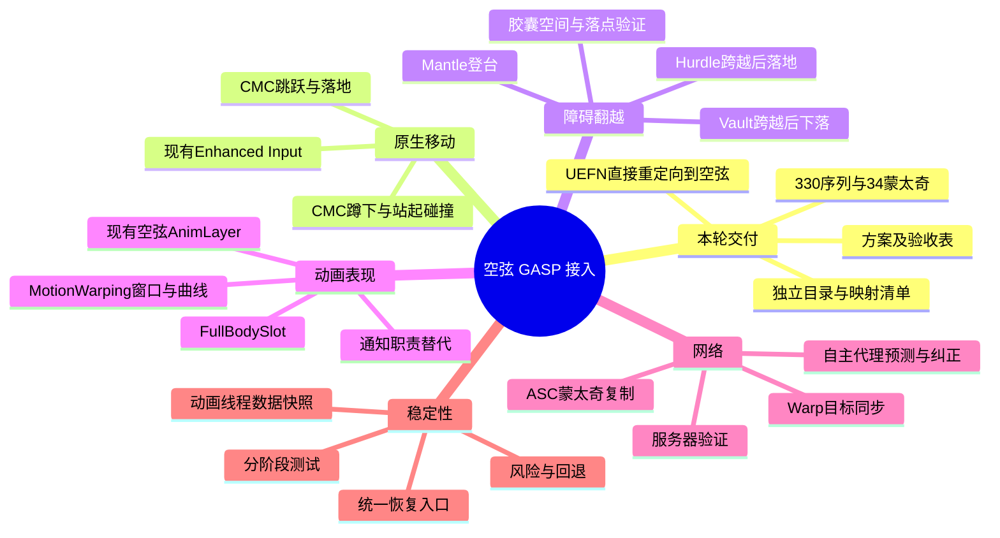
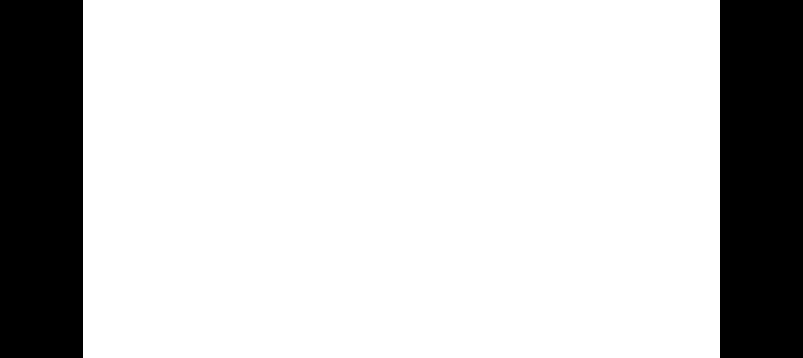

# GASP → 空弦：蹲下、跳跃与障碍翻越接入方案

日期：2026-11-18。工程：`E:/UEProject/RPGDeemo/RPGDeemo.uproject`，Unreal Engine 5.6。

本轮已将本地《游戏动画示例》中 GASP 的 UEFN 原始动画直接重定向到当前玩家空弦骨架，交付 **330 个 AnimSequence + 34 个 AnimMontage = 364 个动画资产**。其中蹲姿 219 个序列，包含原 Crouch 目录的 213 个和 Idle 目录补充的 6 个；跳跃 67 个序列；Traversal 44 个序列和 34 个 Montage。加上重定向与通知等依赖，共新增 374 个包，保留 33 个现有空弦依赖包。全量数据校验、新进程重载、支持 Blueprint 编译及 GameModeTestMap 中 5 类 Montage 播放抽检已通过，并保存了蹲姿、起跳和登台姿态预览。**障碍检测、实际接触对齐和联机玩法尚未接入**，下面给出按现有角色、GAS 和动画层实施的方案。

本文的类名、接口、输入绑定、检测算法和测试用例均为**拟实施设计**；本轮不实现玩法 C++，不修改现有玩家 BP、ABP、GA 或输入配置。动画重定向不等于完整复刻 GASP 的 Motion Matching、Chooser、关卡检测和网络玩法。第 15 节记录实际执行结果与报告；主工程 UBT、Automation Test、障碍接触和联机验证仍待后续实现后执行。



## 1. 已核实事实与交付边界

| 类别 | 本轮已核实 / 拟交付 | 后续接入工作 |
| --- | --- | --- |
| 工程 | `.uproject` 指定 UE 5.6，`RPGDeemo` 为 Runtime 模块 | 按项目现有角色和 GAS 架构扩展 |
| 动画范围 | 330 Sequence + 34 Montage 已生成并通过新进程重载，包含额外 6 条蹲姿 Idle；数据校验与代表动作播放通过 | 全动作衔接、实际障碍接触与尺寸覆盖仍需验收 |
| 重定向 | UEFN 源骨架 → 当前玩家 RetargetReady 空弦；独立输出；主 Retargeter 为 `Rigs/RTG_UEFN_Kongxian_GASP` | 不经旧 Hero 中转，不迁入整套 Sandbox 玩法；最终数量和质量以验收表为准 |
| 支持通知 | 最终保留原包路径下的 BlendOut Notify BP 与枚举，恢复目标 NotifyState 及源参数；未迁入整套 Sandbox | 目标缺少原 BlendProfile 时存在默认回退；区分视觉淡出和权威动作结束 |
| Warp 参考点 | 34 个缺 attach 骨的 Bone provider 窗口已转换 Static；其余 Warp 参数保留，数据校验通过 | 需在实际障碍上细调手部接触，不能据此认定源表现完全等价 |
| 当前角色 | `AWarriorHeroCharacter`、Enhanced Input、ASC、MotionWarping 已存在 | Jump/Crouch/Traversal 的玩法绑定与状态机仍待实现 |
| 动画蓝图 | 当前空弦已有 `KX_ABP_Hero` 和 AnimLayer 体系；现有播放使用 FullBodySlot | 在现有层中增加状态与动画引用，不直接整体替换为 GASP ABP |
| GASP 障碍逻辑 | 已审阅源 `CBP_SandboxCharacter`、相关资产名称、导入引用与编辑器注释 | 不能把源注释审阅当作已在本工程运行验证 |
| 编译与运行 | 支持 BP 编译 0 错误/0 警告；离线工具 BuildPlugin Win64 Development 成功；GameModeTestMap 中 5 类 Montage 播放并推进通过 | 未新增游戏运行 C++/运行插件；工程 UBT、玩法 Automation、接触及联机验收仍待执行，详见第 15 节 |

已删除的 `Content/Assets/KongxianAI` 不属于接入目标，不恢复、不引用。已有其他未提交修改不属于本轮资产处理的授权范围。

## 2. UE 信息、skills 与现有代码接入点

### 2.1 项目信息与证据

| 位置 | 现状与意义 |
| --- | --- |
| `RPGDeemo.uproject:3` | `EngineAssociation = 5.6` |
| `RPGDeemo.uproject:8` | Runtime 模块名 `RPGDeemo` |
| `Source/RPGDeemo.Target.cs:10`、`Source/RPGDeemoEditor.Target.cs:10` | 分别具有 Game 与 Editor Target，IncludeOrder 为 Unreal5_6 |
| `Source/RPGDeemo/RPGDeemo.Build.cs:14` | 已依赖 EnhancedInput |
| `Source/RPGDeemo/RPGDeemo.Build.cs:15` | 已依赖 GameplayTags / GameplayTasks / GameplayAbilities |
| `Source/RPGDeemo/RPGDeemo.Build.cs:17` | 已依赖 AnimGraphRuntime |
| `Source/RPGDeemo/RPGDeemo.Build.cs:18` | 已依赖 MotionWarping；`.uproject:40` 已启用同名插件 |
| `Config/DefaultEngine.ini:5` | EditorStartupMap 为 `/Game/Maps/GameModeTestMap`，可作为后续测试入口 |
| `Config/DefaultInput.ini:92`、`:93` | 使用 EnhancedPlayerInput 与自定义 `WarrriorInputComponent` |

本次读取了主 skill `C:/Users/wayi/.codex/skills/unreal-engine-5/SKILL.md`，并选用两个辅助主题：

- `custom-character-movement.md`：由 `ACharacter`、现有 CMC 与后续 Traversal 网络预测需求触发，重点检查原生跳蹲与自定义移动的边界。
- `anim-montage-cpp.md`：由已有 ASC Montage 入口和 Traversal Montage、Root Motion、结束/中断清理需求触发。

GAS 已是现成接入设施，本次不新建整套能力框架；AI、渲染、UI 不是本轮改造对象，因此未批量加载相邻领域 skills。动画线程风险依据当前代码与本机 UE5.6 头文件核实。

### 2.2 现有入口与真实缺口

| 文件 / 函数 | 现状 | 后续处理 |
| --- | --- | --- |
| `Private/Characters/WarriorHeroCharacter.cpp:22` 构造器 | 设置 CMC 速度、转向与镜头，胶囊初始值为半径 42、半高 96 | 这些是当前 C++ 默认值，可能被 BP 覆盖；不要当作源 GASP 参数直接复用 |
| `WarriorHeroCharacter.cpp:114` `SetupPlayerInputComponent` | :135–141 绑定 Move/Look/锁定/交互/能力分流 | 增加原生跳蹲和 Traversal 意图的明确绑定 |
| `WarriorHeroCharacter.cpp:150` `Input_Move` | 控制器 Yaw 转换移动方向后 `AddMovementInput` | 继续走 CMC；翻越锁定期间由动作状态控制可接受的输入 |
| `Private/Characters/WarriorBaseCharacter.cpp:23` | 已创建 `UMotionWarpingComponent` | 复用现有组件，在动作配置中管理目标名称与有效期 |
| `WarriorBaseCharacter.cpp:49` `PossessedBy` | 服务器初始化 ASC，使用 Mixed GE 复制模式 | 后续核验组件复制实际开启情况，不能用 Mixed 模式替代组件复制开关 |
| `WarriorHeroCharacter.cpp:75` `PossessedBy` | 服务器加载启动数据并授予能力 | 可注册持续可用的 Traversal GA；不能放进随武器卸下的能力组 |
| `Private/DataAssets/StartUpData/DataAsset_HeroStartUpData.cpp:12` | 启动能力通过动态 Spec Source Tags 关联输入 | 可复用；若 Traversal 使用原生输入转 GA，必须确保只走一个触发入口 |
| `Public/Component/Input/WarrriorInputComponent.h:45` | 能力输入只绑定 Started / Completed | 按住型动作需补 Canceled 路径，防止换上下文/打开 UI 后无法释放 |
| `Private/AbilitySystem/WarriorAbilitySystemComponent.cpp:12`、`:25`、`:39` | Montage、模拟播放和 OnRep 均保留 Super 链 | 未来用 ASC/GAS Montage 路径，避免重复 Multicast 播放 |
| `WarriorAbilitySystemComponent.cpp:49`、`:68` | Pressed 尝试激活；Released 只取消 MustBeHeld | 不等于已具备通用 `WaitInputRelease` 事件转发，采用该 AbilityTask 前需单独补齐并测试 |
| `Public/AnimInstances/WarriorCharacterAnimInstance.h:32` | 只有 GroundSpeed / Acceleration / Direction | 增加 Falling、Crouched、竖直速度和 Traversal 快照 |
| `Private/AnimInstances/WarriorCharacterAnimInstance.cpp:20` | 在 `NativeThreadSafeUpdateAnimation` 直接读取 Character / CMC | 先做游戏线程快照，再给工作线程纯计算，详见第 11 节 |

表内 `Public/`、`Private/` 均相对于 `E:/UEProject/RPGDeemo/Source/RPGDeemo/`，行号为本次审阅快照，修改后应按函数名重新定位。

源码目前未发现 Jump/Crouch/Traversal 标签绑定、自定义 CharacterMovementComponent、`PhysCustom` 或 `FSavedMove` 实现。本轮进一步核验：`BP_HeroCharacter` 的 EventGraph 只有 7 个 Pause 逻辑节点，没有 Jump；`DA_InputConfig` 的 NativeInputActions 只有 Move / Look / SwitchTarget / Interact 四项，无 Jump；`IMC_Default` 虽有两项 `IA_Jump` 键映射，但没有消费该 Action 的角色绑定。结论是**键映射存在，跳跃绑定未接通**。`DefaultInput.ini:80–81` 的旧式 Jump 映射也不能替代 Enhanced Input 绑定。

## 3. 独立动画输出与资产验收

### 3.1 源和目标

| 项目 | 包路径 |
| --- | --- |
| 源骨架 | `/Game/Characters/UEFN_Mannequin/Meshes/SK_UEFN_Mannequin` |
| 源网格 | `/Game/Characters/UEFN_Mannequin/Meshes/SKM_UEFN_Mannequin` |
| 目标网格 | `/Game/Assets/Kongxian/SK_Kongxian_UE5_RetargetReady` |
| 目标骨架 | `/Game/Assets/Kongxian/SK_Kongxian_UE5_RetargetReady_Skeleton` |
| 当前空弦主 ABP | `/Game/Assets/Kongxian/HeroAnimation/KX_ABP_Hero` |
| 独立输出根目录 | `/Game/Assets/Kongxian/HeroAnimation/GASP` |
| 主 Retargeter | `/Game/Assets/Kongxian/HeroAnimation/GASP/Rigs/RTG_UEFN_Kongxian_GASP` |
| 最终保留的 BlendOut Notify | `/Game/Blueprints/AnimNotifies/BP_NotifyState_MontageBlendOut` |
| 最终保留的 BlendOut 条件枚举 | `/Game/Blueprints/AnimNotifies/E_TraversalBlendOutCondition` |

使用 UEFN → 空弦的直接映射。Retargeter 的源预览网格、目标预览网格、链映射和姿态必须显式核对；主 Retargeter 已确定为上表路径，其他辅助 Rig 以映射清单为准。不要复用一个源骨架不匹配的旧 Retargeter 仅改文件名。

```text
/Game/Assets/Kongxian/HeroAnimation/GASP/
  Sequences/
    Crouch/                 213 条原 Crouch 分类序列
      Idle/                   6 条额外蹲姿 Idle
    Jump/                    67 条跳跃序列
    Traversal/**             44 条，保留来源子目录结构
  Montages/
    Traversal/**             34 条，保留来源子目录结构
  Rigs/                      本轮独立重定向资源
  Settings/                  为断开源样例依赖保留的独立设置资产，以清单为准
```

动画资产统一在原名之前加 `KX_GASP_`。例如 `M_Neutral_Crouch_Idle_Loop` → `KX_GASP_M_Neutral_Crouch_Idle_Loop`；保留原名后缀与原有分类可以回溯来源，避免按序号重命名后无法定位。

额外 6 条来自源 `/Game/Characters/UEFN_Mannequin/Animations/Idle/`：`M_Neutral_Crouch_Idle_Loop` 和 `M_Neutral_Crouch_Idle_Break_v01` 至 `v05`。只按源 `Crouch` 文件夹批量选择会漏掉这些基础状态素材。

### 3.2 迁移时保留与裁剪的责任

34 个源 Traversal Montage 使用 `DefaultSlot`；独立输出副本改用当前空弦已有的 `DefaultGroup.FullBodySlot`。不能改源 Montage，也不能因为修改 Slot 就声称整套动作已接入现有 ABP。

资产适配保留 MotionWarping NotifyState 窗口、窗口时间和目标名，并保留所有 float 曲线、Root Motion / Root Lock 设置、Sync Markers 与动画长度。引擎 FName 序列化/显示可能把曲线名改为小写，名称比较不区分大小写；仅大小写显示变化不视为语义丢失，验证仍须比对曲线键值、时间和插值语义。Section、播放区段等属性也应逐项核验，不能统一关闭 Root Motion 让动作“看起来不位移”。受影响 Warp 参考点的适配属于下文单列的行为差异，不能用“窗口还在”代替其几何正确性验证。

独立副本已按隔离策略移除 Foley、PoseSearch 与 EarlyTransition 事件，并移除 EditorModifier UserData，断开源样例依赖。保留 MotionWarping 窗口及独立 BlendOut 逻辑。所有删除项目必须写入 JSON：至少包含源/目标资产、Notify 类或类型、原始名称、时间/持续时长、删除原因及替代责任；UserData 删除也需记录类型和来源。不能使用“清空所有通知”的策略误删 MotionWarping 窗口。

最终保留上表原包路径的 `BP_NotifyState_MontageBlendOut` 与 `E_TraversalBlendOutCondition`：重命名源 BP 曾导致目标 Notify 的 GeneratedClass 引用丢失，因此最终在当前无冲突的原路径恢复支持资产，逐个恢复目标 NotifyState 并保留源参数。它们自身无 Sandbox 硬依赖，只保留这两个支持资产，不迁入整套源玩法。`GASP/Notifies/` 下的两份重命名副本已废弃，不是最终引用目标。

保留的通知继续实现 Force Blend Out / If Falling / With Movement Input 的提前淡出判断；这不等于原分骨混合完全保留。12 个 Montage 清理了引用源骨架的 BlendProfile；Notify 按名称查找 `FastFeet_InstantRoot` 时目标骨架没有该 Profile，会使用缺省回退。该降级可能改变脚部/根骨的淡出节奏，需要后续在目标骨架建立等价 Profile 或明确接受统一混合，并通过 PIE 核验。不得仅因 NotifyState 类已非空就声称提前淡出的全部表现已无损。

| 通知 / 数据 | 源责任 | 裁剪后必须替代的责任 |
| --- | --- | --- |
| MotionWarping 窗口 | 在指定时间窗把 Root Motion 对齐到 FrontLedge / BackLedge / BackFloor | 保留；后续玩法需在播放前设置正确目标、动作结束清理目标 |
| `BP_NotifyState_MontageBlendOut` | 根据 Force Blend Out / If Falling / With Movement Input 提前淡出，并按名称找 BlendProfile | 最终在原包路径恢复完整 NotifyState 与源参数；12 个 Montage 的源骨架 BlendProfile 已清理，`FastFeet_InstantRoot` 缺失回退需视觉核验；由权威动作阶段决定何时恢复移动和碰撞 |
| `PoseSearchBranchIn` | 关联原样例 PoseSearch Database / Motion Matching 的候选分支 | 初版改为项目自身动作配置、确定性筛选及显式 Montage / StartTime。普通 Montage 可播放，但失去原 MM 的姿态匹配入口，必须承认衔接差异 |
| Foley 事件 | 源样例的脚步、衣物或身体动作声音事件；具体事件以删除清单为准 | 本工程音频系统补充对应通知/事件。当前动画能播放不代表声音保留，不把 Foley 丢失写成无行为变化 |
| EarlyTransition 事件 | 为源样例提供提前过渡/退出的时点；不与 BlendOut Notify 简单等同 | 在新状态机/动作配置中明确允许过渡的阶段和衔接时点，不能因独立 BlendOut 还在就认为 EarlyTransition 责任已覆盖 |
| EditorModifier UserData | 源编辑流程或 Modifier 元数据，可能关联再生成行为 | 输出已移除以断开依赖；保留的曲线/Markers/通知等烘焙结果仍要校验，后续自动再生成需本工程独立工具与配置 |
| 其他源专有 BP Notify | 具体责任必须从源类逐项审阅 | 逐条映射到本工程事件/音效/脚步/VFX/状态转换；未核实责任的条目标待审阅，不伪造等价实现 |
| `Distance_From_Ledge` 曲线 | 提供动画相对边缘的水平位移参考，参与目标修正 | 保留曲线名称与采样语义；数值涉及源骨架与目标体型时需测量校准，不直接套常数 |

动画资源检查至少包括：364 个动画计数与唯一映射、目标 Skeleton 一致、Montage 引用已指向目标 Sequence、Slot 一致、时长/采样合法、无 NaN/Inf 和百倍根骨缩放、Root Motion 位移范围、float 曲线/Sync Markers/Warp 窗口、Static Warp 参考点的有效性、残留源骨架/样例依赖、输出目录外原资源未被覆盖。364 只计动画，不含 Rig、Retargeter、Notify BP 和枚举等支持资产。代表动作预览覆盖蹲下 Idle/前后侧移/起停、跳跃起跳/空中/落地，以及 Mantle/Hurdle/Vault；数据合法不等于脚底、手掌和障碍对齐已经美术验收。

## 4. 源 GASP 的实际能力与可复刻范围

源资产入口为 `/Game/Blueprints/CBP_SandboxCharacter`，包含 `TryTraversalAction`、`GetTraversalCheckInputs`、`UpdateWarpTargets`、`OnTraversalStart`、`OnTraversalEnd`、`PerformTraversalAction`。本次事实来自源 uasset 中可读名称、导入引用与编辑器注释，未在本工程执行该蓝图；具体 Trace 距离、高度阈值和播放参数不能由文本推断。

源 `E_TraversalActionType` 的语义：

| 类型 | 结果 | 结束状态 |
| --- | --- | --- |
| None | 不执行翻越 | 保持原状态或执行原生 Jump 回退 |
| Mantle | 登上障碍顶部，不越过整个物体 | 顶部有效落点成立后 Walking，否则安全 Falling/失败 |
| Hurdle | 跨过较薄障碍，在近似高度的后方地面落下 | 有效后方地面成立后 Walking |
| Vault | 跨越后进入下落 | Falling，后续由 CMC 处理真实落地 |

这里的“攀爬”应理解为**登台与障碍翻越**。源示例通过临时 `Flying` 允许根运动的 Z 分量，并暂时忽略所穿越障碍的碰撞；这是 Montage 驱动示范，不能据此宣称具备通用墙面攀爬、悬挂横移、爬梯、任意墙面检测或完整联网预测。

源流程先通过 Chooser 筛出匹配 Montage，再由 Motion Matching 结合当前 Pose 与距离选择 Montage 和 StartTime。初版可先以项目自己的动作配置实现正确、可预测的翻越，后续确有需求再评估 PoseSearch/Chooser 体系；不应为了普通蹲下/跳跃强制迁移整套 GASP 数据库。

源注释还说明蹲姿走下边缘时 UnCrouch，源资源并未提供完整的“蹲姿空中 / 蹲姿落地”体系。空弦初版应明确使用同类规则还是另做素材，不能由站姿空中动画静默覆盖后称完整蹲姿跳跃已实现。

## 5. 输入、动作状态与互斥

### 5.1 拟新增输入契约

| 输入 | 建议标签 / 事件 | 责任 |
| --- | --- | --- |
| Jump | `InputTag.Jump`；Started / Completed / Canceled | Started 先按配置尝试 Traversal；不成立才原生 `Jump()`；释放或取消调用 `StopJumping()` |
| Crouch | `InputTag.Crouch`；Started / Completed / Canceled | 初版推荐按住蹲下，后续可提供切换式选项；站起必须走 CMC 碰撞检查 |
| Traversal | `InputTag.Traversal`；Started | 可独立交互键或并入 Jump 的优先尝试。不要同时注册两条相同按键的独立激活链 |
| Move | 复用现有 Move | 正常移动、蹲行；翻越中只采集取消/提前淡出意图，不绕过 CMC 推动角色 |
| Cancel | 使用项目现有取消体系或专用标签 | 由允许取消的动作阶段判断，统一走恢复函数 |

这里只定义行为，不指定未经用户确认的具体按键。不把目前 Roll、Interact 或武器组合键直接占用为新动作。

Jump 的“翻越失败再跳”只适用于**同一次输入的本地即时决策**：候选不成立时直接原生 Jump；已提交或预测启动 Traversal 后若服务器延迟拒绝，不应自动补一次迟到 Jump。此时可能已经松键、落地或处于受击，补跳会造成意外动作。若产品需要跳跃缓冲，应以有有效期的独立输入请求管理，并由服务器重新验证。

### 5.2 状态的唯一来源

运动事实以 CMC 的 MovementMode / CustomMovementMode、`bIsCrouched`、Velocity 为准；Traversal 生命周期由独立组件或 GA 管理；ABP 只读取快照。可用派生状态 `Standing / Crouched / Falling / Traversing` 方便动画表现，但不要再保存另一套可独立写入的 Walking/Falling 布尔状态。

拟新增 `Player.Status.Traversing`、`Player.Ability.Traversal` 等标签时，统一定义在 `WarriorGameplayTags.h/.cpp`。与现有 `Shared.Status.Dead`、受击、翻滚、格挡、锁定、装备切换建立互斥表：

| 触发条件 | 初版推荐规则，均需玩法确认 |
| --- | --- |
| 死亡 / 失去控制 | 禁止开始；进行中立即取消并清理 |
| 硬直 / 重受击 | 禁止开始；是否打断当前动作由阶段配置决定 |
| 攻击、翻滚、装备切换 | 初版与 Traversal 互斥；不要多个 FullBody Montage 抢占而不恢复状态 |
| 锁定目标 | 可保留锁定选择，但临时停止锁定旋转对根运动的干扰；结束恢复上一策略 |
| 蹲下时请求翻越 | 先尝试安全站起；头顶空间不足则拒绝。禁止仅切换动画强行放大胶囊 |
| 同时按 Jump/Crouch | 用输入优先级统一决策，并在本地与服务器使用相同规则 |

## 6. 拟新增类、数据与接口

以下为设计签名和职责，不是已经落地的 C++。初版应先复用原生 CMC，不为了基础跳蹲新增移动组件；只有自定义物理或持续攀爬确有需求时才进入第 10.4 节。

| 拟建 / 拟改对象 | 职责 |
| --- | --- |
| `UWarriorTraversalComponent` | 候选检测、服务器重验、Warp 目标、生命周期/恢复。支持组件 Owner 是现有 Hero |
| `FWarriorTraversalQuery` | 起点、朝向、速度、胶囊状态、请求时间/序号；Trace 参数从配置读取 |
| `FWarriorTraversalResult` | 有效边缘、法线、障碍尺寸、组件引用、局部目标、动作候选及失败原因 |
| `FWarriorTraversalActionDefinition` | 动作类型、适用尺寸区间、Montage、StartTime/PlayRate 策略、Warp 名称、退出规则 |
| `UDataAsset_TraversalConfig` | 集中调试检测尺寸、动作匹配、取消条件、调试绘制；所有推荐值标记需按目标体型调整 |
| 可选 `UWarriorTraversalGameplayAbility` | GAS 互斥/成本/激活与 Montage 生命周期；委托检测和移动给组件，避免把 Trace 复制进 GA |
| 现有 `AWarriorHeroCharacter` | 输入转意图，Jump/Crouch 原生入口，不承载整套检测和 Trace 状态 |
| 现有 `UWarriorCharacterAnimInstance` | 游戏线程快照与动画派生数据 |

建议接口：

```text
QueryTraversal(Query) -> Result + FailureReason
CanStartTraversal(Result) -> bool
RequestTraversal(PredictedResult, RequestId)
ValidateTraversalOnServer(Request, CurrentServerState) -> AcceptedResult
StartTraversal(AcceptedOrPredictedResult)
UpdateWarpTargets(Result, ActionDefinition)
FinishTraversal(Completion / Interrupted / Rejected / OwnerDestroyed / TargetLost)
RestoreTraversalState(FinishReason)
```

`Result` 至少包括 `HasFrontLedge / HasBackLedge / HasBackFloor`、对应位置/法线、`ObstacleHeight / ObstacleDepth / BackLedgeHeight`、`HitComponent`、选定动作 ID、Montage、StartTime、PlayRate。网络请求不能信任客户端直接传来的 Montage 对象、任意位置或任意速度；客户端仅提出候选，服务器用白名单配置和当前世界重建结果。

对移动障碍保留 `HitComponent` 和组件空间位置/朝向，开始/预测回放时变换到世界空间；障碍组件失效、变换跳变或对象无网络身份时应拒绝或安全中断。不要只缓存一次世界坐标然后在移动平台上沿用整段动作。

## 7. 障碍检测与动作选择

### 7.1 `LevelBlock_Traversable` 的边界

源示例前向 Trace 找到 `LevelBlock_Traversable`，调用其 `GetLedgeTransforms`；其边缘信息由 Spline 提供，并根据最小可用宽度钳制靠近端点的目标。这是**有作者标注的可穿越障碍**，不能描述成任意场景几何都可自动攀爬。

本项目建议两级实现：首版使用 `IWarriorTraversable` 或专用组件提供边缘、允许动作类型与局部目标，便于可控验证；通用几何检测作为单独迭代，使用前向 Sweep、顶部向下查询、厚度/后缘探测和落点胶囊重叠检查。两种实现统一输出同一 Result，避免上层依赖源 `LevelBlock_Traversable` 类。

### 7.2 检测伪码

```text
QueryTraversal(Query):
  若死亡、已在翻越、被互斥能力占用、无有效朝向或胶囊无效 -> Reject
  从角色胶囊与移动方向构造前向Sweep
  命中候选障碍；忽略自己、武器、纯表现附件
  若使用标注障碍：请求其边缘数据并钳制端点宽度
  否则：检测前缘/顶面/厚度，按配置生成边缘候选

  检查前缘法线、宽度、角色接近角、障碍高度和可支撑面
  Sweep角色胶囊到前缘入口；入口被其他物体挡住 -> Reject
  检查越过顶面的胶囊空间
  若顶面后段阻挡：缩短有效ObstacleDepth并作废BackLedge候选
  从有效后缘向下查找BackFloor
  检查落点胶囊空间、坡度、最大允许落差与到达路径

  从测量结果筛选 Mantle / Hurdle / Vault 的合法候选
  按配置稳定选动作ID、Montage和起播点；不随机选择网络关键动作
  生成FrontLedge、可选BackLedge / BackFloor及局部坐标
  返回Result；服务器独立重做关键Trace与规则校验
```

上面是结合源流程的拟实施算法，不是源 Blueprint 的逐节点反编译。Sweep 的距离、半径、采样次数、最小宽度、允许坡度、最大落差、Height/Depth 分档均从 DataAsset 读取；当前没有足够证据给出可靠默认常数，需用空弦胶囊、Root Motion 实测与测试关卡确定。

### 7.3 动作选择分阶段

第一阶段为明确的 ActionDefinition 表：按高度/厚度/速度/落差/可用边缘过滤，稳定选择一个配置。先保证“不进墙、不越界、可取消、服务器一致”。第二阶段再用当前 Pose、起步脚、速度、到前缘距离改善起播点和动作接缝。若采用 PoseSearch/Chooser，需单列 Schema/Database/特征/索引重建与性能成本，不能只保留一个源 Notify 就认为 Motion Matching 已接通。

## 8. MotionWarping、曲线与 Root Motion

### 8.1 目标语义

| 目标名 | 源更新语义 | 本工程执行责任 |
| --- | --- | --- |
| `FrontLedge` | 所有有效 Traversal 都设置 | 对齐手部/身体进入前缘的空间参考 |
| `BackLedge` | Hurdle / Vault 设置；其他动作移除 | 对齐后缘跨出位置；不能遗留上一动作的后缘 |
| `BackFloor` | 仅 Hurdle 设置；其他动作移除 | 对齐后方地面；没有有效落点时不能伪造地面 |

目标名必须与复制后 Montage 中 MotionWarping 窗口完全一致。每次动作开始先移除本组件上一个请求拥有的目标，再添加本次目标；不要 `RemoveAllWarpTargets` 误删战斗系统正在使用的目标。若项目共用名称，需通过动作互斥或明确所有权解决冲突。

### 8.2 `Distance_From_Ledge`

源 `UpdateWarpTargets` 在 BackLedge / BackFloor 对应 Warping 窗口末端采样 `Distance_From_Ledge`，得到动画从前缘向后缘/落地点的水平行进距离；修正 BackFloor 的 XY，Z 使用真实地面高度。这不是统一播放速率或直接替代障碍高度的曲线。

重定向会改变身体比例与根运动距离。曲线是否按目标比例需要重新标定，应比较目标动画在同一时点的根位移和实际目标距离；不能假设源曲线数值与空弦天然等价。源注释本身提示斜地与着陆路径障碍可能穿插，所以落点和胶囊路径检查必须成为本工程验收项。

### 8.3 attach 骨缺失与 Static Warp 参考点适配

部分源 Montage 的 `WarpPointAnimProvider = Bone` 引用源专有 attach 骨，目标空弦骨架没有同名骨。最终已将 **34 个受影响窗口**改为 Static provider，并保留 Warp 窗口的起止时间、目标名和其余 Modifier 参数；没有为绕过缺骨错误删除窗口或批量改为 None。引擎缺骨路径会返回 Identity，不会自动改用相邻 hand 骨，因此保留原 Bone 配置不是可用的适配方案。

Static 参考点由窗口 `EndTime` 的源 attach 点/邻近 hand 关系映射到目标动画对应骨姿态，已完成数据适配与校验。目标手骨位置只是可用参考，源 attach 的偏移、旋转以及空弦身体比例可能不同；映射结果仍需在 PIE 和实际通用障碍上逐动作接触细调，不能视为与源 Bone provider 的接触表现完全等价。

本机 UE5.6 `RootMotionModifier_SkewWarp.cpp:308` 明确 Static 的 `WarpPointAnimTransform` 与 root motion track 同坐标系；`MotionWarpingComponent.cpp:235–249` 用目标动画根变换和 Static 点计算相对偏移。适配需满足：

1. 在目标动作实际使用的窗口 EndTime 采样。若从 Montage 转到 Sequence 采样，正确换算 Segment 的起始位置、AnimStart/End、播放速率与循环关系；不能把 Montage 时间直接当作 Sequence 时间。
2. 使用不剥离根运动的目标姿态，计算完整骨链后的组件/动画轨迹空间参考点；不能直接写世界空间坐标、hand 的父骨局部坐标或源 attach 的原始坐标。
3. 对位置、旋转和尺度分别核验。保留源 attach 相对 hand 的空间关系时，明确如何映射到目标体型，不盲目给旋转和位移乘同一个比例。
4. 用静态参考点反算 EndTime 的 Root-to-Warp 偏移，并与预期目标接触点比较；再预览窗口起点、中段、末端及完整动作，不能只验证数字非零/有限。
5. 每个修改窗口记录源骨名、源/目标时间、参考骨/映射方法、源/目标 Transform、保留的窗口属性和待调问题，放入 adaptation 报告。

Static 点冻结的是该动画中定义的参考点，不会让运行时障碍目标失去移动；障碍仍可用组件空间 WarpTarget 跟随。但是它不再依赖运行时指定骨名，目标动画重新编辑、换序列、改 Segment 或调整窗口 EndTime 后必须重新生成参考点。

### 8.4 移动模式

普通 Jump 完全交给 CMC 的 Falling，不用 Flying 播一段跳跃动画代替物理。离散翻越的初版可评估源示例临时 Flying 方案，但需要服务器认可、严格生命周期、Root Motion / 碰撞路径验证和统一恢复；不得同时由 Tick 手动 SetActorLocation 又让 Root Motion 推动胶囊。

保留源 Sequence 的 Root Motion 开关不等于 ABP 应统一使用 Root Motion From Everything。原生 Jump/Crouch 的状态机动画不能与 CMC 再叠加一套未设计的根位移；后续需核验现有 ABP Root Motion Mode，联机 Traversal 优先评估 Montage 路径的根运动消费。不要为了让新序列可见而全局改 Root Motion Mode，影响现有战斗和普通走跑。

**初版先做服务器确认后的动作启动；预测播放与预测胶囊移动分阶段开放。** GA 的 LocalPredicted 只解决能力侧预测的一部分，不能自动记录任意 Flying 切换、碰撞忽略和 Warp 目标以供 CMC 回放。若本地先改变这些移动事实，就必须先解决 SavedMove/目标确认/回放一致性，再宣称支持完整 Traversal 预测。

若目标是长期持续攀爬，则应使用专门自定义移动模式、表面法线/切线速度与网络预测；该需求不包含在当前 GASP 翻越动画包中。Montage 本身不是墙面物理系统。

## 9. 胶囊、碰撞与恢复

### 9.1 蹲下与胶囊

后续先核验角色实例的真实胶囊尺寸与 `GetNavAgentPropertiesRef().bCanCrouch`。通过 Character/CMC 的 `Crouch()/UnCrouch()` 改姿态，利用原生头顶空间检查；不能只把 Mesh 降低或缩放胶囊实现视觉蹲下。站起失败保持蹲姿，镜头不要提前弹回站姿。

蹲姿按 Jump 的规则也需明确：初版不绕过 Character/CMC 的 CanJump 限制；若要“先站起再跳”，必须先实际完成安全 UnCrouch，再以仍有效的输入请求判断能否起跳。头顶不够时保持蹲姿，不用 Montage 把角色弹进低顶。

站姿/蹲姿高度、MaxWalkSpeedCrouched、镜头高度与平滑时间均需目标体型调参，不能照搬源样例。脚底高度、Mesh RelativeLocation、根骨和胶囊底部需在楼梯、斜坡和低顶场景一起测量，避免通过动画根骨偏移掩盖碰撞错误。

### 9.2 翻越时碰撞

默认保留世界阻挡。若动作必须临时忽略所穿越障碍，只忽略经过验证的那一个 PrimitiveComponent/Actor，保存原始状态并在结束/失败恢复；不要把整个 Pawn 的 WorldStatic 碰撞关闭。检测应仍包括旁边墙、顶板、落点障碍和其他角色。

动作结束前重新做落点胶囊 Sweep/Overlap。空间被占用时使用配置好的安全落点或进入 Falling；不能在阻挡中强行恢复大胶囊。移动平台在动作中被销毁也必须进入同一清理路径。

### 9.3 统一恢复函数

`RestoreTraversalState(FinishReason)` 应幂等：同一请求从 Montage End、Ability Cancel、死亡和 OnRep 拒绝等多个入口调用，也只恢复一次。按 RequestId / ActiveActionId 排除旧 Montage 迟到回调对新动作的影响。**BlendOut 开始不一定等于根运动已结束**，单独的提前淡出请求先进入退出阶段，不立即在障碍中间恢复阻挡或切回 Walking。

开始时保存：MovementMode/CustomMode、动作改变过的转向规则、碰撞忽略对象、镜头/锁定策略、拥有的 WarpTargets、临时 Tag/GE Handle、委托/Timer/AbilityTask。结束时：

1. 标记请求已结束并停止本请求的检测/更新，解除委托和 Timer。
2. 仅停止本动作仍在播放的 Montage；遵守当前动作的淡出设置。需要淡出期间保留根运动时，等待对应安全退出阶段；紧急停止则先确定胶囊可用位置，再恢复碰撞。
3. 移除本动作拥有的 WarpTargets、碰撞忽略与临时 Tag/GE。
4. 清理临时速度覆盖/RootMotionSource（如果本动作创建过），恢复转向与输入策略。
5. 根据**当前**地面检查决定 Walking 或 Falling；死亡/外部特殊移动接管时不要盲目回写开始前的 Walking。
6. 恢复镜头/锁定表现，清空活动 Result，广播完成原因与失败码。

特别覆盖 Montage 播放失败、ASC 尚未初始化、网络拒绝、目标消失、角色 EndPlay、快速重复请求和未经过正常 BlendOut 的销毁。游戏状态不能只靠动画 Notify 清理，因为中断或专用服务器动画更新策略可能使 Notify 不可靠。

## 10. 服务器权威、预测与 ASC

### 10.1 原生跳蹲的预测

本机 UE5.6 `D:/UE_5.6/Engine/Source/Runtime/Engine/Classes/GameFramework/CharacterMovementComponent.h:3042–3043` 已定义 `FLAG_JumpPressed` 与 `FLAG_WantsToCrouch`。基础跳蹲沿用 Character/CMC 输入和 SavedMove 机制；不要另外可靠 RPC 每帧同步蹲姿，不用 Multicast 逐客户端修改位置。

服务器最终判断是否可起跳、是否有头顶空间、是否与互斥状态冲突。模拟代理的动画从复制后的移动/蹲姿状态导出。客户端可以平滑镜头，不能由镜头先行变更服务器碰撞事实。

### 10.2 Traversal 请求与确认

```text
本地按键
  -> 本地候选检测 + RequestId
  -> 初版反馈输入/候选，等待确认；后续才开放经过验证的预测启动
  -> 通过约定通道提交请求
服务器
  -> 检查ASC状态/请求序号/距离/方向/障碍身份
  -> 重验关键Sweep、边缘、动作白名单、可用落点
  -> Accept(权威ActionId、目标、StartTime、PlayRate) 或 Reject(原因)
拥有客户端
  -> 预测相符则确认；不符则协调停止/纠正，统一清理旧请求
模拟客户端
  -> 消费复制的动作/移动/目标并显示，不重新选择另一条动画
```

请求通道只能选一个明确方案：若使用 GA LocalPredicted 激活，可通过 GAS TargetData / 预测键传输候选并让服务器确认；若使用专用服务器 RPC，则独立管理请求序号与拒绝/确认。不要同时让 RPC 和 GA 各自决定一次动作并造成双重播放。

权威确认之前可以显示候选和短时姿态反馈，但不能把客户端提供的位置当成合法目标；初版推荐不预测改胶囊移动模式/碰撞。后续开放预测必须提供可重放的 Traversal 意图、目标版本与取消状态，证明 CMC 纠正后的重放能得到同一结果；能力预测键不能代替移动预测历史。

需要同步的最小语义包括 ActionId/RequestId、合法动作配置 ID、障碍组件网络身份及局部目标、服务器接受的开始时刻/位置、StartTime、PlayRate、结束原因。具体字段和序列化形式在实现前定稿；Transform 不应每帧发送，移动平台目标用组件空间减少陈旧数据。

### 10.3 UE5.6 MotionWarping 的实际复制行为

不能套用“WarpTargets 完全不复制”的旧结论。本机 UE5.6：

- `MotionWarpingComponent.cpp:282–286` 构造中调用 `SetIsReplicatedByDefault(true)`。
- `MotionWarpingComponent.cpp:289–296` 对 WarpTargets 使用 Push Model，复制条件为 `COND_SimulatedOnly`。
- `MotionWarpingComponent.h:236–237` 将 WarpTargets 标记为 Replicated。

因此模拟代理可获得引擎复制的目标；**自主代理不会通过这条 SimulatedOnly 路径获得服务器目标纠正**，预测目标与权威确认仍需上面的显式设计。还要处理 Montage 与目标先后到达：不同组件的复制更新没有可依赖的原子到达顺序。服务器应先设置本动作目标再启动权威 Montage，客户端仍需用带 ActionId 的上下文校验，并处理目标晚到。

这里不能简单阻塞或延迟现有 ASC 的 Montage OnRep：ASC/CMC 已负责播放位置与根运动纠正，随意暂停会破坏时间一致性。实现时应选定协调机制，让本动作上下文可在 Montage 消费前恢复目标，必要时依据服务器时间追赶/安全退出；没有有效目标时不能沿用上次动作目标，也不能假定晚到后从窗口头重播总是安全。此项需专门联机测试而非依赖两次 ForceNetUpdate 保证顺序。

不要一边让引擎复制 WarpTargets，一边为模拟代理另发一套没有 ActionId 的不一致目标。专用服务器 Root Motion 与动画更新时间策略也要验证，不能只测试本机 Listen Server。

### 10.4 什么时候扩展自定义 CMC

若后续只是 Montage 驱动的离散翻越，先验证原生 CMC 根运动与现有移动模式能否满足需求。若需要持续墙面移动、新速度积分或可重放的自定义动作意图，再新增 `UWarriorCharacterMovementComponent` 与 `FSavedMove_Warrior`，实现 `Clear`、`GetCompressedFlags`、`SetMoveFor`、`PrepMoveFor`、`CanCombineWith`、`UpdateFromCompressedFlags`、`GetPredictionData_Client` 和相应物理模式。

压缩位只适合意图；复杂 Traversal 目标不能塞进一位布尔。状态变化时禁止合并不兼容 SavedMove，回放时恢复相同意图/必要数据。目标数据需用符合本机版本的 NetworkMoveData/独立确认结构设计，再测试重放一致性。

更换默认 CMC 要通过 `FObjectInitializer.SetDefaultSubobjectClass` 在 Character 构造链注册。当前 Base/Hero 均为无参构造器，需先规划 `FObjectInitializer` 穿过 Base 的签名；不要直接替换所有 BaseCharacter 的 CMC 而让敌人受无关影响。

### 10.5 ASC Montage 生命周期

复用 `UWarriorAbilitySystemComponent::PlayMontage` 与现有 Super 复制链，GA 中可使用 `PlayMontageAndWait` 类任务；确认本机任务选项、取消/BlendOut/Interrupted/Completed 处理。单独 `AnimInstance->Montage_Play` 不自动等价于 GAS 预测和复制。

GA 负责互斥、激活与取消；TraversalComponent 负责检测/目标/恢复；CMC 负责移动；ABP 负责姿态。正常结束、提前淡出、被更高优先级 Montage 替换和服务器拒绝都进入第 9.3 节退出流程，不能只监听 Completed。`OnBlendOut` 是淡出开始，`OnCompleted/OnInterrupted` 与实际安全落点各有语义；必须按动作定义选择何时最终清理，不能所有回调都无条件立即恢复碰撞。

保留的 `BP_NotifyState_MontageBlendOut` 仍会按本地 Falling/输入条件请求淡出；模拟代理未必拥有同样的输入。后续应明确由拥有客户端/服务器决定权威提前退出，模拟端遵循复制状态；恢复 NotifyState 和源参数只保证原动画退出逻辑存在，不构成联网一致性或分骨 BlendProfile 表现无损的证明。ASC 组件本身是否开启复制必须从当前 BP/运行实例核验；`Mixed` 只是 GE 复制模式，不会代替组件复制开关。

## 11. ABP 与动画线程

保留空弦现有 `KX_ABP_Hero`、`KX_MasterAnimLayer_Hero`、武器 AnimLayer 与 ALI 接口。后续扩展 Locomotion 状态与必要接口；不导入源 GASP ABP 直接覆盖玩家现有 AnimClass。新 Montage 仍通过已有 FullBodySlot，优先验证持刀时蹲行、跳跃和翻越是否与上半身/全身层混合兼容。

建议快照字段：GroundSpeed、VelocityLocal、VerticalSpeed、MovementMode、bIsFalling、bIsCrouched、bHasAcceleration、TraversalActionType、bIsTraversing、bCanEarlyBlendOut。字段只表示当前已确认或允许预测的状态，不在工作线程执行 Trace、访问 ASC 状态容器或修改角色。

当前 `WarriorCharacterAnimInstance.cpp:20–31` 在 `NativeThreadSafeUpdateAnimation` 直接读取角色 Velocity、CMC Acceleration、ActorRotation；新增系统应一并修正这一入口：

1. `NativeUpdateAnimation`（游戏线程）检查 Owner/Movement/ASC 有效性，收集完整快照。
2. `NativeThreadSafeUpdateAnimation` 仅使用快照计算方向、混合权重、过渡条件。
3. 复杂动画可使用与本机版本兼容的 AnimInstanceProxy / Property Access，但必须证明数据访问线程安全，不因函数标记 `BlueprintThreadSafe` 就访问任意 UObject。
4. Pawn 重生成、Mesh/AnimClass 切换、Linked Layer 切换时重新初始化引用和状态，防止沿用旧 Owner。

跳跃状态由 CMC/竖直速度区分起跳、上升、下落、落地；不要仅靠“起跳动画播完”驱动物理。蹲姿状态由实际 `bIsCrouched` 决定，站起空间不足时继续蹲行。Relax / Idle Break 在 Falling、Traversing、Dead 等状态禁止进入，避免现有 Idle 计时器在无加速度的空中误触发。

## 12. 性能与调试

Traversal 检测优先由请求事件触发；需要预提示时才在本地可控角色上限频查询，频率由配置与实际性能测量决定。不要给所有敌人、模拟代理和不可见角色每帧跑一组完整 Sweep。缓存角色/Movement/MotionWarping 引用，避免每 Tick FindComponent。

使用复用的 QueryParams 忽略自己与装备，复杂物理查询仅用于必要阶段；正式性能数据需用 Unreal Insights / stat 命令实测。保留可按需开启的 Debug Draw 与结构化日志：RequestId、Role、动作、拒绝原因、目标组件、测量尺寸、选中 Montage、StartTime、恢复原因。调试绘制和逐帧 Warning 日志不能默认长期启用。

失败原因建议包含 NoObstacle / UnsupportedObstacle / FrontBlocked / TopBlocked / NoLanding / LandingBlocked / InvalidState / ServerRejected / TargetLost。这样测试人员能区分“没有匹配动画”和“胶囊确实进不去”，无需从一串通用失败消息猜原因。

## 13. 问题清单、优先级与拟修改文件

| 优先级 | 问题 | 修改方案 | 风险 |
| --- | --- | --- | --- |
| P1 | 普通 PIE 刷怪在预加载类缺失时触发 `FindChecked` 断言（本轮实测） | 后续在 `AWarriorSurvialGameMode::TrySpawnWaveEnemies()` 增加加载完成门控及缺失/失败处理；本轮仅临时隔离刷怪，详见第 15 节 | 现有波次玩法可能崩溃，需优先修复后再进行完整玩法回归 |
| P1 | 源动画骨架不能直接用于空弦 | 本轮直接重定向并独立输出、记录映射；代表姿态已预览 | 全动作四肢比例、脚部滑动、手脚接触仍需人工验收 |
| P1 | 部分 Warp 窗口引用目标不存在的源 attach 骨 | 已将 34 窗口从 Bone 适配为 Static；基于 EndTime 源 attach/hand 关系映射目标姿态，其余 Warp 参数保留 | 数据校验通过，接触表现未验收；坐标系、Montage 时间或手部偏移问题仍需在实际障碍逐动作检查 |
| P1 | Jump/Crouch/Traversal 缺少明确玩法入口 | 后续核验 BP 绑定后补 Enhanced Input 与标签，原生跳蹲优先 | 重复触发、与现有技能键冲突 |
| P1 | 源示例依赖标注障碍、Chooser/MM 与通知 | 首版组件化检测+明确动作配置，逐条替代通知责任 | 不能宣称完整 GASP 视觉与选择器等价 |
| P1 | 翻越中断后可能残留 Flying/碰撞忽略/Tag | 统一幂等恢复，覆盖全部结束原因 | 最严重时角色穿墙、悬空或无法移动 |
| P1 | 自主代理 Warp 目标没有自动权威纠正 | 设计请求确认、目标/ActionId 和拒绝回滚 | 高延迟下瞬移、回弹、错动作 |
| P1 | 以 GA 预测代替 CMC 移动历史，或直接延迟 ASC Montage OnRep | 初版服务器确认启动；未来完整预测需移动回放；显式协调动作上下文与 Montage，不依赖跨组件顺序 | Flying/碰撞忽略无法回放、根运动时点不一致 |
| P1 | BlendOut 开始时直接恢复碰撞/Walking | 增加退出阶段与安全落点；由权威生命周期控制最终恢复 | 淡出仍带根运动时在障碍内部重开碰撞，卡住或弹出 |
| P1 | 动画工作线程直接读 Character/CMC | 游戏线程快照，工作线程纯计算 | 线程竞争、Owner 切换后的陈旧数据 |
| P2 | 源 DefaultSlot 与当前 FullBodySlot 不同 | 本轮仅改独立 Montage 副本的 Slot；已在现有 KX_ABP_Hero 验证 5 类 Montage 播放推进 | 战斗层叠加、完整衔接与全动作权重仍需检查 |
| P2 | 目标骨架缺少源分骨 BlendProfile | 12 个 Montage 已清理源骨架 Profile 引用，Notify 查 `FastFeet_InstantRoot` 缺失时走默认回退 | 脚部/Root 淡出表现有降级；后续建立目标 Profile 或明确接受缺省混合并做视觉验收 |
| P2 | 源动画缺完整蹲姿空中体系 | 明确离地 UnCrouch 规则或补素材 | 低顶/跌落/站起之间可能穿模 |
| P2 | 输入取消和能力释放语义有限 | Canceled 释放、按需补能力输入事件 | 换上下文或 UI 打开后卡状态 |
| P2 | 延迟拒绝 Traversal 后补发 Jump，或模拟端自行根据输入判断退出 | 迟到拒绝只取消/纠正；跳跃缓冲单独管理；退出使用权威动作状态 | 松键后意外跳跃，不同客户端提前退出不一致 |
| P2 | 曲线/目标对斜地和移动物体存在局限 | 检测与落点重验、局部目标、单独测试 | 手脚漂移、穿插、落点误差 |

本轮实际文件范围：

- `Docs/GASP_Kongxian_LocomotionPlan.md`、`Docs/Images/GASP_Kongxian_Poses.png`。
- `Content/Assets/Kongxian/HeroAnimation/GASP/**`：364 个动画与 5 个 Rig/压缩设置支持包。
- `Content/Blueprints/AnimNotifies/BP_NotifyState_MontageBlendOut.uasset` 与 `E_TraversalBlendOutCondition.uasset`。
- `Content/Characters/UEFN_Mannequin/Materials/M_UEFN_Mannequin.uasset`、`Textures/T_UEFN_Mannequin_D.uasset` 与 `Textures/T_UEFN_Mannequin_N.uasset`：源预览依赖闭包中的 3 个材质/纹理包。
- `Scripts/GASP/**`：编辑器离线脚本、工具源及执行说明；`Saved/Codex/GASPRetarget/**` 保存本机阶段工程与验收报告，不作为运行依赖。

现有玩家玩法文件只读。`Scripts/GASP/ToolsPlugin` 仅用于离线 Stage 资产操作，BuildPlugin 的 Win64 Development 编译成功；未作为本项目运行插件接入，也未新增游戏运行 C++。不要把离线工具源码或其编译成功误报为游戏模块已改造/已通过 UBT。

后续实现拟修改：

- `Source/RPGDeemo/Public/Characters/WarriorHeroCharacter.h` 与 `Private/Characters/WarriorHeroCharacter.cpp`：输入和组件入口。
- `Source/RPGDeemo/Public/WarriorGameplayTags.h` 与 `Private/WarriorGameplayTags.cpp`：新动作标签。
- `Source/RPGDeemo/Public/Component/Input/WarrriorInputComponent.h`：必要的 Canceled 处理。
- `Source/RPGDeemo/Public/AnimInstances/WarriorCharacterAnimInstance.h` 与 `Private/AnimInstances/WarriorCharacterAnimInstance.cpp`；Hero AnimInstance 的 Idle 规则。
- 新增 `Public/Component/Traversal/WarriorTraversalComponent.h`、对应 Private `.cpp`、TraversalTypes / Config DataAsset；如选 GAS，再新增 Traversal GA。
- 只有扩展 CMC 时才修改 Base/Hero 构造链和新增 Movement 文件；本轮不做该改造。
- 后续资产接入涉及 `DA_InputConfig`、`IMC_Default`、空弦现有 ABP / ALI / AnimLayer、独立测试关卡及障碍配置；逐阶段改动并保留回退路径。

## 14. 分阶段测试方案

| 阶段 | 验证内容 | 通过标准 / 证据 |
| --- | --- | --- |
| A 本轮资产 | 计数、映射、Skeleton、Montage Sequence 引用、Slot、所有 float 曲线、Sync Markers、通知、Root Motion、依赖清理 | JSON 逐项检查；可追溯源/目标包路径；原资源未覆盖；曲线按 FName 语义与键值比较 |
| A 本轮 Warp 适配 | 缺 attach 骨窗口的 Static 点；Montage→Sequence 时间；Root-to-Warp 偏移 | adaptation 报告逐窗口列方法与变换；未适配项显式失败，不静默写 Identity |
| A 本轮视觉 | 代表性蹲姿/Jump/Mantle/Hurdle/Vault 的目标模型预览；手部接触与窗口结束位置 | 保存预览证据和问题清单；不以帧数据合法替代视觉验收 |
| B 原生跳蹲 | Editor 编译与 UBT；按下/释放/取消；低顶站起失败；离边下落；坡地/楼梯 | 胶囊、动画、镜头一致；无重复输入与卡蹲；PIE 记录 |
| C 单机 Traversal | 标注障碍入口、三种动作、无匹配/阻挡/移动障碍/目标销毁 | 检测与动作一致；不穿墙；所有失败均恢复；PIE 记录 |
| D 联机 | Listen Server + 至少双客户端，后续专用服务器；延迟/丢包；预测拒绝；目标/Montage交错到达；晚加入 | 客户端与服务器位置/状态收敛，无双播和永久 Flying；BlendOut期间无提前重开碰撞；目标与 Montage 先后可处理 |
| E 战斗联调 | 持斧/太刀、攻击/翻滚/受击/死亡/装备切换/锁定 | FullBodySlot 与能力互斥符合规则，旧战斗功能回归通过 |
| F 自动化 | 动作筛选边界、无落点/边缘宽度、请求序号、重复恢复、旧回调 | Automation Test 覆盖确定性规则和状态恢复，不写逐行镜像实现的测试 |

推荐后续测试矩阵：薄/厚障碍、边缘端点、不同高度、坡顶、斜地、低顶、落点有人、动态门、旋转/平移平台、连续按键、输入上下文切换、动作刚开始/中段/落地前受击、角色重生与场景 Travel。没有可靠测量前不硬编码动作高度阈值；延迟与丢包设置作为测试工况记录，按目标产品网络条件调整。

后续有 C++/反射修改时应关闭编辑器后执行完整 UBT，再进入 Editor 编译/加载验证。参考命令，仅作为后续执行入口，本轮未执行：

```powershell
& 'D:/UE_5.6/Engine/Build/BatchFiles/Build.bat' RPGDeemoEditor Win64 Development '-Project=E:/UEProject/RPGDeemo/RPGDeemo.uproject' -WaitMutex
```

Automation Test 的实际测试名与运行命令必须在测试实现后补录，当前不捏造已存在的测试套件。Editor 资产创建、Blueprint 编译、UBT 编译和 PIE 是不同验证项，不互相替代。

## 15. 本轮实测结果与证据

以下结果于 2026-11-18 在 UE 5.6.1 完成。报告根目录为 `E:/UEProject/RPGDeemo/Saved/Codex/GASPRetarget/`；脚本顺序与复用限制见 `Scripts/GASP/README.md`。数据检查、资产加载、Blueprint 编译和 PIE 动画播放分别列出，玩法未接入的项目保持未执行状态。

- `retarget_result.json`：源/目标映射、30 条链映射、通知与 UserData 裁剪记录。
- `adaptation_validation.json`：`passed = true`；曲线/同步标记、根位移、姿态抽样、Montage 结构与 34 项 Warp 适配。
- `stage_export_manifest.json`：`reload_passed = true`；独立新进程重载及依赖/哈希清单。
- `delivery_manifest.json`：新增 374 个包，保留 33 个现有空弦依赖包。
- `editor_compile.json`、`pie_validation.json`、`preview_poses.json`：实际编辑器编译、5 类 Montage 播放与姿态预览记录。
- `protection_validation.json`：`allUnchanged = true`，1,357 个源/现有资源包的保护哈希检查通过。
- 交付后重新核对 374 个目的包 SHA256，与 `delivery_manifest.json` 全部一致；补齐的只读 `InspectTarget.py` 导出独立候选清单，33 个依赖包集合与原清单一致。
- `final_editor_state.json`：停止 PIE 后的地图、dirty package 状态和当前编辑器日志检查。

| 验证项 | 目标 / 范围 | 实测结果 | 证据 |
| --- | --- | --- | --- |
| 动画总量 / 实际交付 | 330 Sequence + 34 Montage = 364；加支持资源共 374 个新包 | 全部保存、通过新进程重载并交付；33 个现有依赖包未覆盖 | `retarget_result.json`、`stage_export_manifest.json`、`delivery_manifest.json` |
| Crouch | 219 Sequence，含 6 Idle | 已生成并保存 | 重定向映射清单 |
| Jump | 67 Sequence | 已生成并保存 | 同上 |
| Traversal | 44 Sequence + 34 Montage | 已生成并保存 | 同上 |
| 目标骨架 / 直连重定向 | UEFN → RetargetReady 空弦，30 条链精确映射 | 已完成重定向和目标骨架重载检查；代表姿态无整体爆骨或朝向翻转 | `Rigs/RTG_UEFN_Kongxian_GASP`；`retarget_result.json`；下方预览 |
| Montage 结构 | 34 个使用目标序列、FullBodySlot；Section、裁剪、Blend 参数 | 数据比对通过；清理源骨架 BlendProfile 的差异单列 | `Saved/Codex/GASPRetarget/adaptation_validation.json` |
| float 曲线 / Sync Markers | 全部曲线键值、键时间与同步标记保留；FName 显示大小写可变 | 330 个序列比对通过，曲线/Marker 不一致计数均为 0 | 同上；每序列 `curves_equal`、`sync_markers_equal` |
| Root Motion 设置与位移 | 保留原设置，检查源/目标有效根位移方向与尺度 | 314 个有效位移片段方向点积 > 0.99；位移尺度约 1.004875–1.004877 | 同上；每序列 `root` 数据 |
| 缺骨 WarpPoint | 34 个受影响 Bone provider → Static；其余 Warp 参数保持 | 适配和参数校验完成；实际障碍接触细调待做 | 同上；`warp_adaptations` 34 项 |
| Notify / UserData 裁剪 | Foley/PoseSearch/EarlyTransition 事件与 EditorModifier UserData 移除 | 已处理并记录；需在后续接入补对应职责 | 机器可读裁剪记录和依赖检查 |
| MontageBlendOut 支持资产 | 原包路径 BP + 枚举；目标 NotifyState 和源参数恢复 | 已恢复，新进程重载和 BP 编译通过；各条件淡出和接触效果仍待玩法验收 | `stage_export_manifest.json`、`editor_compile.json` |
| 分骨 BlendProfile 差异 | 12 个 Montage 清理源骨架 Profile 引用；缺 `FastFeet_InstantRoot` 回退 | 已知降级，尚未视觉验收 | 适配报告及风险清单 |
| 姿态有限性抽检 | 330 序列 × 5 时刻 × 7 骨 | 1650 姿态、11550 Transform 均有限 | `Scripts/GASP/AdaptValidateStage.py`；报告 `pose_sample_count` / `finite_transform_count` |
| 代表动作视觉预览 | 蹲姿 Idle 0.0s、站立起跳 0.4s、登台 1.0s | 已在 GameModeTestMap PIE 截图；未见整体爆骨/翻转；非完整动作与接触验收 | `preview_poses.json`、`Docs/Images/GASP_Kongxian_Poses.png` |
| 原资源保护 | 不覆盖现有玩家、尾巴/裙子配置或源动画；不恢复 KongxianAI | 1,357 个被保护包 SHA256 均未变；33 个现有依赖保留 | `protected_hashes.json`、`protection_validation.json`、`delivery_manifest.json` |
| Editor 加载 / BP 编译 | 目标编辑器加载 369 个输出根资产；新支持 Notify BP 编译 | 330 Sequence + 34 Montage + 5 Rig/设置可加载；BP 0 错误 / 0 警告 | 当前编辑器执行记录、`editor_compile.json` |
| 离线 Stage 工具编译 | `Scripts/GASP/ToolsPlugin`；UBT BuildPlugin Win64 Development | 已成功；工具未作为运行插件接入 | 离线 Stage 工具构建日志 |
| 工程 UBT build | 游戏运行 C++ / RPGDeemoEditor | 本轮未新增运行 C++；未由离线 BuildPlugin 结果替代本项 | 后续实现需执行实际工程 UBT |
| Automation Test | 后续规则与恢复测试 | 未实现 / 未执行 | 不存在测试通过结论 |
| PIE / 现有角色动画播放 | GameModeTestMap；真实玩家 KX_ABP_Hero | Climb、Catch/Hurdle、Catch/Mantle、Catch/Vault、Catch/Cliff 共 5 类 Montage 均成功启动并推进 | `pie_validation.json`，`passed = true`；临时停用 PIE GameMode 刷怪 Tick |
| 通用障碍接触 / 联机 | 实际检测、落点、碰撞恢复、双客户端等 | 玩法未接入，未执行；不以 Montage 播放替代 | 后续按第 14 节逐项验收 |
| 停止 PIE 与 GC | 返回编辑器 GameModeTestMap | `not_running`；dirty 内容包/地图包均为空；当前会话日志未见新的 FPyReferenceCollector/残留 World 断言 | `final_editor_state.json` |



图中从左到右是登台 1.0s、起跳 0.4s、蹲姿待机 0.0s，后方为原玩家站姿。三个前景模型用于独立序列姿态预览；没有摆放对应障碍，不能用此图判断手掌贴合、落点、胶囊路径或完整动作中的裙子/尾巴穿插。预览 Actor/Camera 仅存在于 PIE，没有保存到关卡。

**实测发现的现有 P1 阻断问题：**普通 PIE 的波次刷怪曾在 `Source/RPGDeemo/Private/GameModes/WarriorSurvialGameMode.cpp:175`，`AWarriorSurvialGameMode::TrySpawnWaveEnemies()` 的 `PreloadedEnemyClassMap.FindChecked(SpawnerInfo.SoftEnemyClassToSpawn)` 触发 `Pair != nullptr` 断言。调用时异步预加载表尚无对应类；本轮未修改该运行代码。为了完成动画抽检，仅在该次 PIE 世界提前停用 GameMode Tick，未修改 GameMode 蓝图、关卡或源配置。因此本轮通过结论仅覆盖上述动画测试，不代表普通波次玩法回归通过。后续优先补加载完成后的刷怪门控，以及缺失类/预加载失败处理，再做完整玩法 PIE。

抽检的边界：5 个时刻与 7 根骨的有限性检查不是全帧、全骨骼的姿态证明；314 项根位移方向/尺度比较不是完整 Yaw、脚掌滑动或手部接触验收。少量无有效位移的序列不纳入方向/尺度统计，不应被当作检查失败。Root Motion 方向正确也不能证明胶囊沿途无碰撞。以上限制保留到实际 PIE 与关卡接触验收完成。

## 16. 风险与实施顺序

先完成独立资产检查与少量代表动作视觉预览，再接通原生 Jump/Crouch；随后实现单个受控障碍上的 Mantle，验证恢复与目标同步后扩展 Hurdle/Vault，最后评估更精细的动作选择和 MM。这样每个阶段都有可验证的胶囊、动画和网络结果。

最高风险是把播放动画当作完成玩法、缺 attach 骨的 Static Warp 点在错误空间/时间采样、临时 Flying/碰撞忽略未恢复、淡出开始即在障碍内部恢复碰撞、客户端任意目标被信任以及动画线程跨对象读状态。其次是 GA 预测未覆盖移动回放、复制顺序被错误依赖、蹲姿离地素材不足、源曲线与目标比例不同、移动平台的陈旧目标、裁剪 Foley/EarlyTransition/PoseSearch 后没有补对应职责，以及新 FullBody 动作干扰现有战斗层。

回退以独立动画输出目录、清单中的两个原路径支持资产和原有角色配置为边界；后续每个阶段只改变必要引用并记录差异。两个支持资产虽使用源包名，也只处理本轮清单确认创建/恢复的文件，不批量操作整个 `/Game/Blueprints`。失败时撤销对应配置/引用，不删除或恢复本轮范围外的现有资源，不通过全局碰撞/网络开关绕过问题。

## 17. 官方参考与版本依据

以下为 Epic 官方参考入口，本文对本机 UE5.6 的具体行为优先采用已核实的引擎源码。在线页面可能随文档默认版本更新；实现时应选择 5.6 并核对实际 API。本次尝试联网核验入口时遇到 TLS 连接失败，因此不声称已在线逐页阅读全文。

- [Game Animation Sample Project](https://dev.epicgames.com/documentation/en-us/unreal-engine/game-animation-sample-project-in-unreal-engine)：样例定位和动画系统范围。
- [IK Rig Animation Retargeting](https://dev.epicgames.com/documentation/en-us/unreal-engine/ik-rig-animation-retargeting-in-unreal-engine)：IK Rig / IK Retargeter 的源、目标和链映射。
- [Motion Warping](https://dev.epicgames.com/documentation/en-us/unreal-engine/motion-warping-in-unreal-engine)：Warp 窗口、目标与 Root Motion。
- [Networked Movement in the Character Movement Component](https://dev.epicgames.com/documentation/en-us/unreal-engine/understanding-networked-movement-in-the-character-movement-component-for-unreal-engine)：服务器移动、客户端预测与纠正。
- [Enhanced Input](https://dev.epicgames.com/documentation/en-us/unreal-engine/enhanced-input-in-unreal-engine)：输入 Action、MappingContext 与触发阶段。
- [Animation Optimization](https://dev.epicgames.com/documentation/en-us/unreal-engine/animation-optimization-in-unreal-engine)：线程安全更新和动画数据访问。
- [Animation Notifies](https://dev.epicgames.com/documentation/en-us/unreal-engine/animation-notifies-in-unreal-engine)：Notify / NotifyState 的责任边界。
- [Gameplay Ability System](https://dev.epicgames.com/documentation/en-us/unreal-engine/gameplay-ability-system-in-unreal-engine)：能力生命周期、预测与现有 ASC 的整合背景。

本机核验源文件：

- `D:/UE_5.6/Engine/Source/Runtime/Engine/Classes/Animation/AnimInstance.h:1373`：游戏线程采集与工作线程更新约定。
- `D:/UE_5.6/Engine/Source/Runtime/Engine/Classes/GameFramework/CharacterMovementComponent.h:3042`：原生 Jump/Crouch 压缩标记。
- `D:/UE_5.6/Engine/Plugins/Animation/MotionWarping/Source/MotionWarping/Private/MotionWarpingComponent.cpp:282`：默认组件复制；`:295` 为 SimulatedOnly 目标复制条件。
- `D:/UE_5.6/Engine/Plugins/Animation/MotionWarping/Source/MotionWarping/Private/RootMotionModifier_SkewWarp.cpp:308`：Static WarpPoint 与 Root Motion Track 的坐标约定。
- `D:/UE_5.6/Engine/Plugins/Animation/MotionWarping/Source/MotionWarping/Private/MotionWarpingComponent.cpp:171`、`:235`：Bone / Static provider 的 EndTime 姿态与相对变换计算。
- `D:/UE_5.6/Engine/Plugins/Runtime/GameplayAbilities/Source/GameplayAbilities/Private/Abilities/Tasks/AbilityTask_PlayMontageAndWait.cpp:18`、`:91`：BlendOut 与 End 回调的不同语义。

源 GASP 审阅对象：`CBP_SandboxCharacter`、`E_TraversalActionType`、`S_TraversalCheckResult`、`LevelBlock_Traversable`、Traversal Montage、`BP_NotifyState_MontageBlendOut`、`E_TraversalBlendOutCondition`、`PoseSearchBranchIn` 与 `PSD_Traversal` 引用。源资产文本只能支持已列出的流程和依赖事实，不支持未经执行的数值性能或联机正确性结论。
