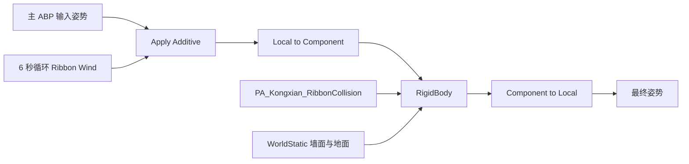
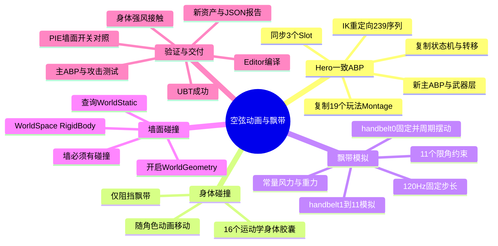

# 空弦：飘带碰撞与 Hero 动画蓝图

本文同时包含飘带物理实现、逐函数说明、武器 Socket 修复和飘带显示修复，采用 GitHub Markdown 格式。所有验证结论以各章节注明的测试范围为准。

## 动画按来源整理后的目录

`/Game/Assets/Kongxian/HeroAnimation` 下按重定向来源分类：

```text
HeroAnimation/
  KX_ABP_Hero                       主 ABP 保留入口路径
  KX_MasterAnimLayer_Hero
  KX_AnimLayer_HeroAxe
  HeroOriginal/                     Hero → 空弦
    Sequences/
    BlendSpaces/
    Montages/                       保留 Equip、HitReact 等用途子目录
  ParagonAuroraViaHero/              ParagonAurora → Hero → 空弦
    Sequences/
    Montages/
```

来源依据：Hero 原 `Animations/Axe` 44 个资产；原 `Animations/Sword` 195 个资产对应 ParagonAurora，导入记录包含 `Orion/Characters/Heroes/Ice`。4 个带数字后缀的批处理命名冲突副本归入 Aurora 组并在清单注明。Hero 玩法蒙太奇和移动混合空间归入 HeroOriginal。ABP 和共享层保留入口路径；旧动画路径通过重定向器兼容，不直接删除重定向器。

原文下方提及的动画根目录路径为生成当时路径。整理后应到上述来源目录中查找同名动画；完整逐资产 old/new 对照见 `Saved/KongxianRibbon/animation_folder_organization.json`。

## 飘带部分不可见的修复

优先级 P1。飘带为薄片几何，原 UE 材质 `2550_全` 的 `Two Sided=false`。薄片扭转后，部分三角形朝向背面，被背面剔除，产生看似断开的显示。通过后台 Blender 只读检查，handbelt 骨权重覆盖的面使用材质槽 2（2550_全，检测到 3070 个相关面），并非凭材质名称猜测。

处理：保留原材质，复制为 `/Game/Assets/Kongxian/M_Kongxian_Ribbon_TwoSided`，开启 `two_sided`；保持原贴图、着色连接和 Opaque 模式。仅将 `SK_Kongxian_UE5_RetargetReady.materials[2]` 指向新副本。材质槽 2 同时覆盖部分其他表面，因此这些表面也使用双面渲染；没有重新拆分网格或改动蒙皮。

具体 API：

```python
mat = unreal.EditorAssetLibrary.duplicate_asset(source_path, new_path)
mat.set_editor_property('two_sided', True)
mat.set_editor_property('used_with_morph_targets', True)
unreal.MaterialEditingLibrary.recompile_material(mat)
slots = mesh.get_editor_property('materials')
slot = slots[2]
slot.set_editor_property('material_interface', mat)
slots[2] = slot
mesh.set_editor_property('materials', slots)
unreal.EditorAssetLibrary.save_loaded_asset(mat)
unreal.EditorAssetLibrary.save_loaded_asset(mesh)
```

`duplicate_asset` 保留原资产；`two_sided` 允许背面三角形被渲染；`used_with_morph_targets` 允许该材质用于表情变形网格；`recompile_material` 重新生成材质着色器；修改 `material_interface` 将新材质接入网格；`save_loaded_asset` 持久化结果。诊断记录在 `Saved/KongxianRibbon/ribbon_visibility_fix.json`。

双面显示不增加真实厚度，不修复几何破面或穿模，也不能让严格侧向、投影面积接近零的薄片保持可见。双面会增加原本被剔除表面的渲染成本；本次没有重新构建 C++，无需 UBT，材质通过 Editor 编译/保存检查，原物理配置保持不变。

## 飘带实现逐函数说明

以下为实际代码与运行节点的说明。核心源码为 `Plugins/KongxianRibbonTools/Source/KongxianRibbonTools/Private/KongxianRibbonTools.cpp`。编辑器工具只生成资产；游戏运行使用引擎内置 RigidBody，不会每帧调用生成函数。

### 1. 入口与参考骨骼

`IConsoleManager::Get().RegisterConsoleCommand` 注册 `Kongxian.BuildRibbonPhysics`，绑定自定义 `KongxianRibbon::Build()`。

|函数|实际作用|
|---|---|
|`LoadObject<USkeletalMesh>`|加载厘米单位的 RetargetReady 网格|
|`FPaths::FileExists`、`FindPackage`|目标已存在则退出，不覆盖|
|`USkeletalMesh::GetRefSkeleton`|读取骨骼层级与参考姿态|
|`FReferenceSkeleton::FindBoneIndex`|用实际名称查找骨骼并检查缺失|
|`GetParentIndex`|查找父骨索引|
|`GetRefBonePose`|读取相对父骨的参考变换|

逐级执行 `LocalTransform * ParentComponentTransform` 得到参考组件空间变换。源码数组名为 `Global`，但这里不是关卡世界坐标。所需骨骼缺失则提前返回，避免生成部分损坏资产。

### 2. 创建资产与刚体

`CreatePackage` 创建资产包，`NewObject<UPhysicsAsset>` 创建独立物理资产。`Capsule(...)` 是自定义 lambda，用于按骨节端点拟合胶囊。

```cpp
USkeletalBodySetup* Body = NewObject<USkeletalBodySetup>(Asset);
Body->BoneName = Bone;
Body->PhysicsType = bSimulated ? PhysType_Simulated : PhysType_Kinematic;
Body->DefaultInstance.SetCollisionEnabled(ECollisionEnabled::QueryAndPhysics);
Body->DefaultInstance.SetObjectType(ECC_PhysicsBody);
Body->DefaultInstance.SetResponseToAllChannels(ECR_Block);
Body->DefaultInstance.SetMassOverride(bSimulated ? .015f : 1.f, true);
```

`NewObject<USkeletalBodySetup>` 建立骨体配置；`BoneName` 将刚体绑定骨骼。`PhysType_Kinematic` 随输入动画移动；`PhysType_Simulated` 接受物理求解。`SetCollisionEnabled` 开启查询和物理碰撞；`SetObjectType` 指定物体通道；`SetResponseToAllChannels` 设置默认响应，具体身体/飘带配对再由资产碰撞表过滤。`SetMassOverride` 指定质量；模拟骨节质量为 0.015 kg。`LinearDamping=1` 衰减平移，`AngularDamping=3` 衰减转动。

`FTransform::InverseTransformPosition` 把组件空间端点转换到所属骨骼局部空间。`FKSphylElem` 保存胶囊中心、半径、旋转和直柱长度。中心为端点均值，直柱长度为端点距离减去两个半径。`FQuat::FindBetweenNormals(UpVector, SegmentDirection)` 将胶囊局部 Z 长轴对齐骨链。

`Body->AggGeom.SphylElems.Add` 写入胶囊形状；`Asset->SkeletalBodySetups.Add` 将骨体加入资产。飘带半径用 `FMath::Clamp(SegmentLength*.22, 2, 3.5)` 限制为 2～3.5 cm。末端骨没有下一节，沿上一节方向外推。

### 3. 身体碰撞与过滤

handbelt0 是运动学锚点；handbelt1～11 模拟。另生成 16 个运动学身体胶囊，绑定 pelvis、脊柱、头和双侧四肢。身体胶囊跟随主 ABP 姿态，作为模拟飘带的障碍物，身体本身不布娃娃化。

`UPhysicsAsset::UpdateBodySetupIndexMap` 更新骨名到刚体索引的映射。索引 0～11 是飘带，12～27 是身体。`DisableCollision(I,J)` 禁用所有飘带内部配对及身体内部配对，保留飘带与身体碰撞。该实现没有飘带自碰撞。

### 4. 约束连接

`NewObject<UPhysicsConstraintTemplate>` 创建关节模板，`DefaultInstance` 是 `FConstraintInstance`。`ConstraintBone1` 指向子骨，`ConstraintBone2` 指向父骨，共 11 个关节。

|调用|作用|
|---|---|
|`SetLinearXLimit(LCM_Locked,0)`|锁定 X 相对位移|
|`SetLinearYLimit(LCM_Locked,0)`|锁定 Y 相对位移|
|`SetLinearZLimit(LCM_Locked,0)`|锁定 Z 相对位移，避免链条散开|
|`SetAngularSwing1Limit(ACM_Limited,35)`|允许第一方向弯曲 35°|
|`SetAngularSwing2Limit(ACM_Limited,35)`|允许第二方向弯曲 35°|
|`SetAngularTwistLimit(ACM_Limited,20)`|限制轴向扭转为 20°|
|`SetDisableCollision(true)`|禁用被此约束连接的刚体互撞|
|`SetProjectionParams(true,.1f,.1f,5.f,15.f)`|配置关节误差投影修正|
|`GetRelativeTransform`|把公共组件空间关节框架转换到双方各自骨局部空间|
|`SetRefFrame(Frame1/Frame2, ...)`|设置双方关节参考框架，避免初始化错位|
|`Asset->ConstraintSetup.Add`|将关节保存进物理资产|

关节 X 轴沿链方向，与胶囊长轴使用的局部 Z 不是同一约定。双方关节从同一个锚点转换得出，否则模拟初始化时可能突然弹开。

### 5. 持续摆动的动画数据

`A_Kongxian_Ribbon_Wind` 为 6 秒、30 fps、181 关键帧的循环叠加序列。`AnimPoseExtensions.get_reference_pose` 取得骨架参考姿态；`get_bone_pose(..., LOCAL)` 读取手带根骨局部变换。保留参考位置/缩放，旋转叠加正弦偏移：

```python
phase = 2 * math.pi * frame / 180
offset = unreal.Rotator(
    pitch=6 * math.sin(phase * 2),
    yaw=4 * math.sin(phase), roll=0
).quaternion()
rotation = ref.rotation * offset
controller = sequence.controller
controller.open_bracket('Continuous kinematic ribbon anchor sway')
controller.set_bone_track_keys('handbelt0', positions, rotations, scales)
controller.close_bracket()
```

`Rotator.quaternion` 将角度转为四元数。`open_bracket/close_bracket` 组织动画数据修改；`set_bone_track_keys` 写入骨骼平移、旋转、缩放轨道。第 0 和第 180 帧相位相同，形成循环。

运动学 handbelt0 周期转动，带动后续模拟链持续运动。原序列也包含其他 handbelt 轨道，但开启模拟后，它们的最终姿态主要由刚体求解决定。`ExternalForce=(4,2,0)` 提供固定世界方向外力；常量外力本身可能最终达到平衡，持续摆动主要由周期运动的锚点提供。

### 6. 后处理节点与每帧运行

|蓝图节点|作用|
|---|---|
|Linked Input Pose|接收主 ABP 的动作|
|Sequence Player|循环播放风摆序列|
|Apply Additive|将局部叠加旋转加入输入姿态|
|Local To Component|转为组件空间骨姿态|
|RigidBody|计算重力、外力、关节约束及接触后的模拟骨姿态|
|Component To Local|把结果转回局部骨姿态|
|Output Pose|交给后续蒙皮渲染|

通过 `mesh.set_editor_property('post_process_anim_blueprint', bp.generated_class())` 将后处理绑定网格。它在主 ABP 后执行，不需要修改主状态机。物理改变骨骼，已有蒙皮权重使网格跟随变形，并没有重新计算蒙皮权重。

RigidBody 设置：OverridePhysicsAsset 指向专用 PA；SimulationSpace=WorldSpace；bEnableWorldGeometry=true；OverlapChannel=ECC_WorldStatic；CachedBoundsScale=2；Alpha=1；不冻结输入姿态。WorldGeometry 收集和物理接触由引擎 `FAnimNode_RigidBody` 完成，我们没有自行逐帧用射线把飘带推开。

测试墙调用 `set_collision_profile_name('BlockAll')` 和 `set_mobility(STATIC)`。墙必须有碰撞几何并通过该通道查询被发现；纯显示模型不会阻挡。

### 7. 求解精度、保存与诊断

求解设置：PositionIterations=16、VelocityIterations=4、ProjectionIterations=2、FixedTimeStep=1/120。分别增加位置/速度约束求解、投影修正次数和固定时间步精度。增加精度会增加计算成本，不等于任何场景都不会穿透。

|函数|作用|
|---|---|
|`SetPreviewMesh`|指定物理资产预览模型|
|`UpdateBoundsBodiesArray`|更新用于计算物理资产范围的骨体列表|
|`MarkPackageDirty`|标记待保存|
|`FAssetRegistryModule::AssetCreated`|通知资产注册表|
|`UPackage::SavePackage`|保存为 uasset|
|自定义 `Report`|检查骨名、胶囊数量、12 飘带骨体、11 约束并输出结构报告|
|自定义 `DumpRibbonRuntime`|输出当前 Editor/PIE 后处理设置及最终骨变换|
|`GetPostProcessInstance`|取得实际后处理动画实例|
|`HandleExistingParallelEvaluationTask(true,true)`|等候并完成已存在的并行动画评估|
|`GetBoneTransform`|读取最终骨骼姿态|
|`FJsonSerializer::Serialize`|将诊断结构转成 JSON|
|`FFileHelper::SaveStringToFile`|写入 Saved/KongxianRibbon 报告|

诊断胶囊由输出骨变换重建，不是直接读取 Chaos 接触流。原有 UBT、Editor、PIE 测量结果和风险说明见后面的验证章节。这里未新增 Automation Test。

项目：`RPGDeemo`，Unreal Engine 5.6。模型使用 `/Game/Assets/Kongxian/SK_Kongxian_UE5_RetargetReady`，单位为厘米，根骨缩放为 1。原 MMD、Blender 文件、Hero 资产和原自动生成 PhysicsAsset 均保留。

## 问题与优先级

|优先级|原问题|实现|
|---|---|---|
|P1|纯叠加风摆动画不响应身体、墙面|独立 PhysicsAsset + 后处理 RigidBody|
|P1|直接使用 Hero 动画会绑定旧骨架|IK 批量重定向、复制主 ABP 和动画层|
|P1|目标骨架缺少 Hero 蒙太奇插槽|复制 DefaultSlot、UpperBodySlot、FullBodySlot 的分组注册|
|P2|强风接触身体时默认求解迭代不足|16 位置迭代、4 速度迭代、2 投影迭代、1/120 秒固定步长|

## 完整实现路径

1. 检查 `.uproject`、Build.cs、Target.cs、原 Hero 动画类及现有空弦骨骼。选用已修正单位的 RetargetReady 网格，避免再次引入根骨 100 倍缩放。
2. 在 `Plugins/KongxianRibbonTools` 增加 Editor 模块。Python 无法直接编辑 PhysicsAsset 的原生骨体和约束数组，因此由 C++ 创建专用新资产。
3. 以参考姿态累计骨骼全局变换，按相邻骨端点生成胶囊，再转换回各骨骼局部空间。胶囊长轴为局部 Z，约束 X 轴沿骨链。
4. 为 `handbelt0..11` 建立 12 个飘带碰撞体；`handbelt0` 为运动学固定根，其余 11 个模拟。相邻骨使用 11 个关节连接，锁定位移，摆动限制 35°、扭转 20°。
5. 为 pelvis、spine_01、spine_03、head、双侧 upperarm/lowerarm/hand/thigh/calf/foot 建立 16 个随动画移动的身体胶囊。身体不布娃娃化，角色动作由主 ABP 决定。
6. 开启飘带与身体碰撞；关闭飘带内部互撞和身体内部互撞，避免细长链自身抖动。这不是完整布料自碰撞方案。
7. 在已有 `ABP_Kongxian_RibbonWind_Post` 接入以下动画链：



8. `RigidBody.OverridePhysicsAsset` 指向新资产；SimulationSpace=WorldSpace，bEnableWorldGeometry=true，OverlapChannel=WorldStatic，CachedBoundsScale=2，Alpha=1。不冻结输入姿势。
9. 默认外力为世界坐标 `(4,2,0)`。循环动画的根飘带骨加入小幅周期旋转：pitch=6°×sin(2t)、yaw=4°×sin(t)，周期 6 秒。运动学根持续带动模拟骨链，因此静止角色也会摆动；模拟骨的最终姿势由碰撞求解决定。
10. 从 `ABP_Hero` 复制并通过 `RTG_KongXian` 重定向主 ABP、Master 层、Axe 层及其序列、混合空间和蒙太奇。保留原状态机、转移规则、变量、插槽和无骨架的共享 `ALI_Hero` 接口。批处理自动替换动画引用及动画层父类。
11. 向目标 Skeleton 同步 Hero 插槽。另复制 `/Game/PlayerCharacter/Montages` 的 19 个玩法蒙太奇，复用已有 KX 序列，通过原生对象引用替换将它们全部绑定到新骨架，保留蒙太奇段落与通知配置。
12. 在独立测试关卡验证墙面开关对照、向身体方向的强风接触、持续摆动，以及主 ABP、武器层和攻击蒙太奇的实例运行。

## 使用入口与涉及文件

|用途|路径|
|---|---|
|网格|`/Game/Assets/Kongxian/SK_Kongxian_UE5_RetargetReady`|
|主动画蓝图|`/Game/Assets/Kongxian/HeroAnimation/KX_ABP_Hero`|
|动画层父类|`/Game/Assets/Kongxian/HeroAnimation/KX_MasterAnimLayer_Hero`|
|斧头动画层|`/Game/Assets/Kongxian/HeroAnimation/KX_AnimLayer_HeroAxe`|
|玩法蒙太奇|`/Game/Assets/Kongxian/HeroAnimation/Montages`|
|物理资产|`/Game/Assets/Kongxian/PA_Kongxian_RibbonCollision`|
|后处理|`/Game/Assets/Kongxian/ABP_Kongxian_RibbonWind_Post`，已赋给网格|
|风摆序列|`/Game/Assets/Kongxian/A_Kongxian_Ribbon_Wind`|
|测试关卡|`/Game/Assets/Kongxian/Tests/L_RibbonCollisionTest`|
|生成和诊断源码|`Plugins/KongxianRibbonTools/Source/KongxianRibbonTools/Private/KongxianRibbonTools.cpp`|
|模块配置|同模块 `KongxianRibbonTools.Build.cs`、插件 `.uplugin`、项目 `.uproject`|
|详细测量报告|`Saved/KongxianRibbon/*.json`|

角色 Mesh 使用新网格，Anim Class 使用 `KX_ABP_Hero`。它沿用原 `UWarriorHeroAnimInstance` 的角色/移动数据协议，应使用 `AWarriorHeroCharacter` 或其派生角色。装备系统动态调用 `LinkAnimClassLayers` 时应传入新 `KX_AnimLayer_HeroAxe`，能力配置引用新蒙太奇。原 Hero 的角色、装备和能力配置没有全局替换。

墙面必须有有效碰撞，并能通过 WorldStatic 查询被找到；纯可见模型、关闭碰撞的墙无法阻挡。该实现针对静态环境，不承诺移动门/动态物体的完整交互。

## 验证结果与复现

- UBT：`Build.bat RPGDeemoEditor Win64 Development -Project=E:\UEProject\RPGDeemo\RPGDeemo.uproject -WaitMutex -NoHotReloadFromIDE`，成功。
- Editor：后处理蓝图编译零错误、零编译警告；3 个新 Hero 动画蓝图通过引擎 Python 编译并保存。
- 重定向：239 个序列双帧采样均为有效有限变换；3 个 ABP、3 个混合空间、4 个原动画库蒙太奇，另补 19 个玩法蒙太奇。玩法蒙太奇引用验证全部使用新骨架。
- 墙面：测试墙中心 X=70 cm，厚度 15 cm，近面 X=62.5 cm。开碰撞时尾骨 X≈59.413 cm，加胶囊半径≈3.087 cm 正好贴墙；关墙碰撞后尾骨 X≈85.162 cm。证明场景碰撞确实参与求解。
- 连续摆动：8 秒采样 24 帧，贴墙时尾骨 Y、Z 仍分别变化约 1.14 cm、1.21 cm；锚骨旋转持续变化。
- 身体：测试外力暂改为 (-14,-2,0)，关闭墙碰撞。飘带与大腿/小腿接触，调优后的测量姿态最深重叠约 0.011 cm。测试后恢复默认风力和墙面碰撞。
- 测量胶囊由最终骨骼姿态重建，不是直接读取 Chaos 接触流；上述误差属于指定测试姿态，不代表任意动作均零穿插。
- PIE：验证 `KX_ABP_Hero`、后处理和 `KX_AnimLayer_HeroAxe` 实例并存；新轻攻击蒙太奇 `montage_play` 返回有效长度约 2.267 秒。
- 组合运行记录：9 秒测试内 GroundSpeed 从 0 到 100 cm/s，再回到 0；bHasAcceleration 同步切换；随后成功连接新武器层并播放/结束攻击蒙太奇。见 `hero_locomotion_pie_samples.json`。
- 主 ABP 图结构对照：源/新版本均为 11 个图；AnimGraph 均 17 个节点，UnarmedLocotion 状态图均 8 个节点；待机序列与移动混合空间引用已替换为 KX 资产。
- 本次使用实际 Editor/PIE 验证，未新增 Automation Test；未做 Shipping 打包或全动作极限压力测试。

复现命令：

```text
Kongxian.BuildRibbonPhysics       # 仅创建新资产，存在则拒绝覆盖
Kongxian.ValidateRibbonPhysics    # 骨体/约束结构报告
Kongxian.DumpRibbonRuntime        # 当前 PIE 或 Editor 姿势和设置
Kongxian.SyncHeroSlots            # 停止 PIE 后同步目标插槽
Kongxian.DuplicateHeroMontages    # 停止 PIE 后复制并重映射玩法蒙太奇
```

## 风险与调节

- 这是胶囊刚体骨链，视觉网格边缘可能超出胶囊；特殊姿势仍可能需要调节身体胶囊半径和飘带权重，不应据单次验证承诺完全不穿模。
- 关闭飘带自碰撞，因此折叠时可与自己相交。
- 120 Hz 子步和更高迭代增加求解成本；本次没有正式帧耗基准。大量同屏角色应增加 LOD/距离停算策略并测量。
- 物理风力采用世界坐标，角色转向后风向仍固定；需要随角色风向时可单独扩展。
- 传送、极端加速和大步长可能造成瞬时拉伸/穿透，应在传送时重置动画物理。
- 新蒙太奇保留原游戏通知与效果引用，武器挂点、伤害和特效的全部玩法联调不在本次动画/碰撞验证内。
- Editor 工具模块只负责生成和诊断；运行使用引擎内置 RigidBody 与已保存资产，不依赖工具命令。

## 思维导图



UE skill：`unreal-engine-5`，辅助主题 `collision-profiles-channels`、`plugin-module-configuration`。选用依据是 PhysicsAsset/RigidBody 与新 Editor 模块；动画部分保留现有原生 AnimInstance，未新建 GAS、网络或渲染系统，因此不加载那些领域。

## 武器 Socket 修复

空弦原先没有 Hero 的武器 Socket，附着到缺失名称时会落在网格原点附近。新增 `Kongxian.SyncHeroSockets`，不覆盖已有挂点：从 Hero 复制名称与父骨，按参考姿态转到组件空间后，适配目标骨局部坐标；偏移按 0.8 缩放作为体型适配初值。

- AxeBackSocket → spine_02：未装备时背挂。
- AxeRighthandSocket → hand_r：装备时持握。
- 同步 MagicShieldSocket、WeaponTrailSocket。

改动：目标 Skeleton、Editor 工具 CPP。UBT Development Editor 编译成功；PIE 中挂点存在且父骨正确，附着测试通过，Idle/Axe Idle 运行时右手挂点随手骨移动。原 Hero Skeleton 不变。报告：Saved/KongxianRibbon/hero_sockets_report.json。手指握紧程度、头发与背挂斧头穿插仍需按最终武器尺寸美术微调；未承诺所有武器通用。未新增 Automation Test。

整理验证：共移动/归档 265 个动画资产。HeroOriginal：44 序列、3 混合空间、19 蒙太奇（66）；ParagonAuroraViaHero：195 序列、4 蒙太奇（199）。3 个 ABP 保留原入口路径并通过 Editor Python 编译；所有归档动画存在且使用空弦目标骨架。主 ABP、Axe 动画层直接依赖已指向新文件夹，原动画目录下未分类动画数为 0。仅资产移动，无 C++ 变化，不需 UBT，未为目录移动重复 PIE。旧路径重定向器保留以兼容其他角色/能力引用。

## 2026-11-06 武器自碰撞与太刀收刀修复

- 原因：BP_Kanata、BP_HeroAxe 的 WeaponMesh 为 QueryAndPhysics，阻挡 Pawn。武器挂载在角色内部时会触发角色胶囊的穿透修正，造成额外侧移或抬升。上一轮只忽略 Camera，未消除 Pawn 自碰撞。
- 修改：两个武器蓝图的装饰 WeaponMesh 设为 NoCollision；独立 WeaponCollisionBox 仍由攻击通知开启 QueryOnly，保留伤害 Overlap。
- 原因：BP_Kanata.HeroWeaponData.DefaultWeaponAbilities[1] 的 InputTag 为 InputTag.Unequip.Kanata，但 AbilityToGrant 指向 GA_Hero_UnequipAxe。
- 修改：该能力引用改为 GA_Hero_UnequipKanata。基础 IMC_Default 的 Two=IA_Equip_Kanata；持刀 IMC_Kanata 的 Two=IA_Unequip_Kanata。保留与现有蒙太奇通知一致的 Axe 事件标签。
- 验证：两个武器蓝图在 Editor 编译并保存。PIE 未装备和持斧状态分别施加世界 X 正方向移动，8次采样中 Y=-500、Z=97.649999 均保持不变。模拟实际 Two 按键，首次太刀挂 AxeRighthandSocket，再次挂 AxeBackSocket；角色位置始终(-450,-500,97.649999)。本轮日志未检出 Accessed None / Script Exception。
- 限制：仅资产修改，未运行 UBT 或 Automation Test；尚未覆盖多人、坡面、连续战斗中断与各方向组合输入。
