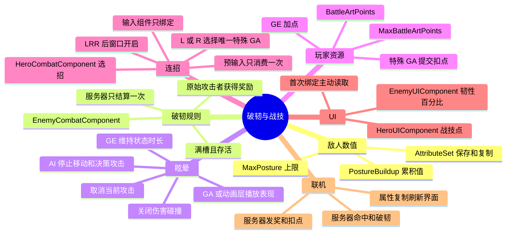
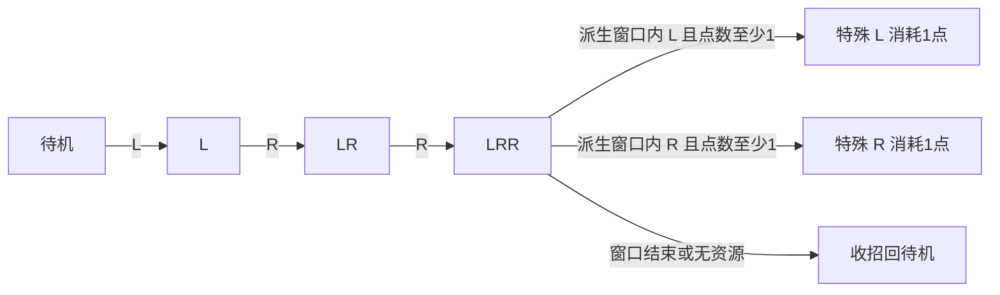

# 韧性、破韧与战技派生：RPGDeemo 程序设计

## 总结

**敌人韧性数值和玩家战技点均由角色身上的 GAS AttributeSet 保存；EnemyCombatComponent 处理破韧规则，HeroCombatComponent 处理连招选择，GA 执行动作，GE 改属性和维持眩晕，UIComponent 广播显示数据。**

这里的“韧性条”指**受击累积槽**：从 0 开始，受击上涨，到上限时破韧。它不是从满值向下扣的护甲值。建议代码命名为 `PostureBuildup`，避免混淆。战技点命名为 `BattleArtPoints`，与已有的 `CurrentRage` 分开。

玩法闭环：有效命中 → 敌人韧性累积 → 满槽且未死亡 → 敌人眩晕 → 造成这次破韧的玩家获得 1 战技点 → 玩家完成 LRR，在派生窗口按 L 或 R → 对应特殊攻击 GA 成功提交时消耗 1 点。

本文件是**待实施方案**。本次只写设计文档，未新增属性、函数、GA、GE 或蓝图节点。下文标为“拟新增”的接口均不是当前项目已有接口。

- 项目：`E:/UEProject/RPGDeemo/RPGDeemo.uproject`，UE 5.6，运行模块 `RPGDeemo`。
- 现有依赖：`GameplayAbilities`、`GameplayTags`、`GameplayTasks`、`EnhancedInput`、`UMG`、`AIModule`。
- 验证地图：`/Game/Maps/GameModeTestMap`。
- 本方案替代旧 [CombatSystemProgramDesign.md](CombatSystemProgramDesign.md) 中“普通攻击逐次积攒 WeaponGauge”的资源规则；旧文档的招式配置、单招 GA、派生解析思想仍可复用。旧文档所提新增类也尚未实施。

## 1. 思维导图



## 2. 第一版玩法规则

以下是原型默认值，可放在敌人配置或招式配置中调整，并非其他游戏的原版数值。

| 项目 | 第一版规则 |
| --- | --- |
| 敌人韧性 | 初始 0，上限 100；每种敌人可单独配置 |
| 普通 L、普通 R | 示例韧性积累分别为 10、20；独立于生命伤害 |
| LRR 第三招 | 示例积累 30；“R”表示重击输入，不是键盘技能键 R |
| 眩晕 | 3 秒；期间仍可扣血，韧性不再累积，不重复奖励 |
| 眩晕结束 | 韧性归零；随后 1 秒破韧保护，保护期也不累积 |
| 奖励归属 | 服务端结算时，把韧性推到上限的最后一击玩家获得 1 点 |
| 多个敌人同时破韧 | 每个敌人、每轮破韧各奖励一次；点数受上限限制 |
| 点数 | 初始 0，上限先设 1；满点再破韧不存欠账 |
| 特殊派生 | 仅从当前 LRR 动作的派生窗口进入；L、R 各一个特殊动作 |
| 消耗 | 每个特殊动作消耗 1 点；开始成功后即使空挥或受击取消也不返还 |
| 无点数时 | LRR 收招结束；窗口内的 L/R 不切特殊招，也不借用旧缓存启动新攻击 |
| 同一击同时击杀并满槽 | 死亡优先，不眩晕、不奖励战技点 |
| 重生与切武器 | 本版死亡重生清零；切武器保留角色战技点 |

第一版不做脱战自动衰减，先把闭环跑通。后续可加“未受有效攻击 3 秒后每 0.2 秒衰减固定值”，使用服务器 Timer / 周期 GE，不需要给每个敌人加常驻 Tick。

## 3. 数据到底放在哪里

当前 `AWarriorBaseCharacter` 构造函数已经为每个角色创建 `UWarriorAbilitySystemComponent` 和 `UWarriorAttributeSet`。因此先扩展现有 AttributeSet 即可；**每个敌人和玩家各有自己的实例，不会共享这些数值**。

| 数据或行为 | 所属位置 | 原因 |
| --- | --- | --- |
| PostureBuildup、MaxPosture | 敌人的 `UWarriorAttributeSet` 实例 | 接入 GE 修改、数值限制、复制和属性变化通知 |
| BattleArtPoints、MaxBattleArtPoints | 玩家的 `UWarriorAttributeSet` 实例 | 与技能费用、奖励和复制统一；不随攻击 GA 结束而消失 |
| 正常/眩晕/恢复阶段、破韧轮次、奖励标记 | `UEnemyCombatComponent` | 这是敌人的战斗规则和运行状态 |
| 当前招式、派生窗口、预输入、待执行派生 | `UHeroCombatComponent` | 这是角色连招状态，与具体物理按键解耦 |
| 眩晕持续时间和状态 Tag | `GE_Enemy_Staggered` | GE 到期移除 Tag；便于复制、免疫和移除效果 |
| 眩晕动画 | 拟新增 `GA_Enemy_StaggerPresentation` 或动画层 | 动画中断不应该改变实际眩晕时长 |
| 韧性条百分比、点数图标 | `EnemyUIComponent`、`HeroUIComponent`、Widget | 显示只读数据，不决定奖励、眩晕或费用 |

`UAttributeSet` 继承的是 `UObject`，不是 `UActorComponent`；它是由角色创建、交给 ASC 管理的属性集合。不要为了“放到组件里”再在 CombatComponent 保存一份相同数值。

**第一版选择：继续使用现有 UWarriorAttributeSet。** 未来不同敌人和武器的属性差异很大时，再拆成 `UEnemyPostureAttributeSet` 与 `UHeroCombatResourceAttributeSet`，并由各自角色在初始化时创建、注册。现在没有必要同时迁移 ASC 到 PlayerState。

如果将来要求点数在更换 Pawn、死亡复活后保留，再考虑 PlayerState 持有 ASC，或由服务器保存并重新初始化点数；GameInstance 不提供多人权威复制能力，不适合作为本功能的战斗资源来源。

## 4. AttributeSet 与 GE 配置

### 4.1 拟新增属性

```cpp
// 以下是接口示意，需补全声明、初始化、复制注册和 OnRep 实现。
UPROPERTY(BlueprintReadOnly, ReplicatedUsing=OnRep_PostureBuildup)
FGameplayAttributeData PostureBuildup;
ATTRIBUTE_ACCESSORS(UWarriorAttributeSet, PostureBuildup)

UPROPERTY(BlueprintReadOnly, ReplicatedUsing=OnRep_MaxPosture)
FGameplayAttributeData MaxPosture;
ATTRIBUTE_ACCESSORS(UWarriorAttributeSet, MaxPosture)

UPROPERTY(BlueprintReadOnly, ReplicatedUsing=OnRep_BattleArtPoints)
FGameplayAttributeData BattleArtPoints;
ATTRIBUTE_ACCESSORS(UWarriorAttributeSet, BattleArtPoints)

UPROPERTY(BlueprintReadOnly, ReplicatedUsing=OnRep_MaxBattleArtPoints)
FGameplayAttributeData MaxBattleArtPoints;
ATTRIBUTE_ACCESSORS(UWarriorAttributeSet, MaxBattleArtPoints)
```

默认初始化：`PostureBuildup=0`、`MaxPosture=100`、`BattleArtPoints=0`、`MaxBattleArtPoints=1`。具体敌人的上限通过现有 StartUpData 中的初始化 GE 覆盖。

约束：`MaxPosture >= 1`；`PostureBuildup` 限制在 `[0, MaxPosture]`；战技点和上限按整数使用，点数在 `[0, MaxBattleArtPoints]`。点数虽然是 GAS 浮点属性，奖励与消费只能传整数。上限变化后也要修正当前值。

在 `PreAttributeChange()` 中限制当前值，同时在 `PostGameplayEffectExecute()` 对 Instant GE 的结算值做限制；只加前者不能覆盖所有 BaseValue 修改路径。`OnRep_*` 调用 `GAMEPLAYATTRIBUTE_REPNOTIFY`。

复制：韧性当前值/上限使用 `COND_None`，让相关客户端都能显示敌人头顶条；点数当前值/上限使用 `COND_OwnerOnly`，其他玩家默认不需要看到。每项注册使用 `DOREPLIFETIME_CONDITION_NOTIFY(..., REPNOTIFY_Always)`。还需检查角色和 ASC 是否实际启用了复制；`SetReplicationMode(Mixed)` 只选择 GE 复制模式，并不等于启用组件复制。

### 4.2 拟新增 GE

| 资产建议名 | 类型 | 配置 |
| --- | --- | --- |
| GE_Enemy_AddPosture | Instant | `PostureBuildup`，Add，SetByCaller `Shared.SetByCaller.PostureDamage` |
| GE_Enemy_ResetPosture | Instant | `PostureBuildup`，Override，0 |
| GE_Enemy_Staggered | Has Duration | 3 秒；授予 `Shared.Status.Staggered`；不堆叠、不通过重复命中刷新 |
| GE_Enemy_PostureRecovery | Has Duration | 1 秒；授予 `Enemy.Status.PostureRecovery` |
| GE_Hero_GrantBattleArtPoint | Instant | `BattleArtPoints`，Add，+1 |
| GE_Hero_CostBattleArtPoint | Instant | `BattleArtPoints`，Add，-1；作为两个特殊 GA 的 Cost GE |

UE 5.6 的 GE 编辑器中，授予状态 Tag 使用 **Components → 添加 Target Tags Gameplay Effect Component → Granted Tags**。不要仅把状态填入 Asset Tags；Asset Tags 描述效果自身，不能代替施加给角色的状态。

**Tag 表示状态，属性表示数量。** 即使上限只有 1，也不要靠 `Player.HasBattleArtPoint` Tag 计数。第一版可直接读属性判断；如果为了 UI 方便增加这个派生 Tag，必须统一从属性推导，不能形成第二份权威值。

## 5. 命中到破韧的实际接入链路

目前可见源码链路是：

```text
UHeroCombatComponent::OnHitTargetActor
→ 向攻击者发送 Shared.Event.MeleeHit
→ 攻击 GA 生成/应用伤害 GE
→ UGEExecCalc_DamageTaken::Execute_Implementation
→ UWarriorAttributeSet::PostGameplayEffectExecute 的 DamageTaken 分支
```

**韧性结算接在服务端伤害已确认的位置，不能接在武器 Overlap 或 UI 更新上。** Overlap 只说明碰到了，不说明这击通过了闪避、格挡、免疫和重复命中验证。

第一版建议沿用现有 `DamageTaken` 作为生命伤害 Meta Attribute，不必立刻重写整个 ExecCalc：

1. 给招式配置增加 `PostureDamage`。调用现有 `MakeHeroDamageEffectSpecHandle()` 后，通过 `Assign Tag Set By Caller Magnitude` / `SetSetByCallerMagnitude()` 写入 `Shared.SetByCaller.PostureDamage`。
2. 服务器验证目标、距离、敌我、攻击实例与伤害段。一次命中同时生成生命伤害和韧性积累的候选数据。
3. `DamageTaken` 结算分支先扣生命值，计算 `ActualHealthDamage = OldHealth - NewHealth`。先处理死亡，再决定是否继续累计韧性。
4. 第一版只有 `ActualHealthDamage > 0` 才计韧性；被完全防住、闪避和免疫的攻击不计。如果以后要做“零血伤也削韧”，另增加明确的有效攻击判定，不能单纯检查是否 Overlap。
5. 从该伤害 Spec 读取 PostureDamage，并取得原始攻击者 ASC，把结果传给敌人 `HandleConfirmedAttack()`。由它检查当前阶段和攻击资格。
6. 敌人处于正常阶段时，使用**原始攻击者 ASC** 创建并对敌人应用 `GE_Enemy_AddPosture`。新 GE 使用原伤害 Context，保留原始 Instigator，不要把敌人自己覆盖成来源。第一版没有有效来源 ASC 的伤害只处理生命，不累计韧性；未来需要无来源环境削韧时，再单独定义服务端构造 Context 的入口。
7. `PostGameplayEffectExecute()` 收到 `PostureBuildup` 修改并限制范围；如果达到上限，向该敌人 CombatComponent 调用 `TryEnterStagger()`，传入该次 GE 的 Context。

生命伤害和韧性积累按上述顺序显式串起来，可保证“一击击杀并满槽”时只执行死亡。不依赖两个不同 GE 在客户端通知到达的先后顺序。

拟新增接口职责示意：

```cpp
// UEnemyCombatComponent；以下函数名均为拟新增。
void HandleConfirmedAttack(
    const FGameplayEffectContextHandle& SourceContext,
    float ActualHealthDamage,
    float PostureDamage);

bool TryEnterStagger(const FGameplayEffectContextHandle& SourceContext);
void OnStaggerEffectRemoved();
void OnPostureRecoveryEnded();
void StopAttacksAndDisableDamageCollision();
```

每招韧性值先独立配置，不直接套用现有 `(BaseDamage + AttackPower) / DefensePower` 公式。例如高伤害招可以低削韧，慢重击可以高削韧。后续再加独立韧性抗性或部位倍率。

如未来需要多种护盾、抗性计算，再增加 `PostureDamageTaken` Meta Attribute 和独立/合并 ExecCalc。Meta Attribute 不复制；无论何种实现，同一次命中只能走一条韧性结算入口，不能新旧方案同时加值。

## 6. 满槽、眩晕与奖励如何只执行一次

`EnemyCombatComponent` 维护三个状态：`Normal → Staggered → Recovery → Normal`，另设一个仅服务器使用的同步进入保护 `bProcessingBreak`。

```text
TryEnterStagger(Context)                  // 仅服务器
  检查：敌人存活、Normal、未在处理破韧、当前槽已满
  设置 bProcessingBreak = true           // 在嵌套应用 GE、发事件之前
  应用 GE_Enemy_Staggered
  如果效果被免疫/应用失败：清保护；不发奖励；允许后续有效攻击重新尝试
  如果成功：
    Phase = Staggered
    BreakSerial += 1
    停止移动，取消攻击 GA，关闭武器与双手伤害碰撞
    标记本轮奖励已处理
    找到有效原始攻击者，对其应用加点 GE
    清 bProcessingBreak
```

奖励边界：

- 每个敌人每轮只奖励一次，不能在“当前值等于最大值”的每次通知中发奖。
- `BreakSerial` 和本轮已处理标记用于审计与防重；标记放在真正发奖励之前，避免应用 GE 引发嵌套回调后二次处理。
- 奖励来源使用 `Context.GetOriginalInstigatorAbilitySystemComponent()`，再检查其 Avatar 是否是存活玩家、敌我关系是否正确。不要用敌人当前锁定目标、最近看见的玩家、`GetPlayerCharacter(0)` 或武器 Actor 来决定归属。
- 联机中服务器顺序处理两名玩家的命中：先跨阈值且成功造成破韧的那次获奖；后到的一击处于 Staggered，不再获奖。
- 具有合法服务端来源 ASC 的环境攻击也可破韧，但来源不是玩家时不发战技点；完全没有有效来源 ASC 时，第一版不累计韧性，不能任意找一个玩家当来源。
- 点数满时仍进入眩晕，但不储存额外奖励；不要在点数后来减少时补发这次奖励。
- 现有 `OverlapActors` 只按碰撞开放阶段去重。多段招式应明确 `AttackInstanceId + HitGroupId + Target`，并在服务器每个伤害段只结算一次。

### 眩晕期间不能只停动画

进入眩晕需要同时处理：

1. 取消带“敌人攻击”分类 Tag 的活动 GA；不要取消死亡等所有能力。
2. 对攻击、移动技能添加 `Shared.Status.Staggered` 激活阻止条件；仅阻止新 GA 不会自动结束正在运行的 GA。
3. `AAIController::StopMovement()` 停止当前移动请求。
4. 设置 Blackboard `bIsStaggered=true`；行为树移动/攻击分支使用可触发 Observer Aborts 的 Decorator，避免停下后下一帧又 `MoveTo`。
5. 强制关闭当前武器、左手、右手的**伤害碰撞**。保留角色受击检测，使玩家能在眩晕时继续输出。
6. 播放眩晕表现；普通 HitReact 在 Staggered 期间应被抑制，死亡仍可打断眩晕表现。

眩晕表现 GA 不会因为添加 Staggered Tag 就自动激活。可给它配置 `Event.Enemy.PostureBreak` 的 Gameplay Event Trigger；服务端确认眩晕 GE 成功后，只发送一次事件到敌人，Payload 的 Instigator 保留攻击者、Target 为敌人，由 ServerInitiated 表现 GA 播放 Montage。也可以让 AnimBP 直接监听 Staggered 状态进入眩晕动画层。两种表现方案择一，避免重复播放；表现激活失败不重复发奖，也不擅自撤销已生效的眩晕 GE。

用服务端 Stagger GE 的移除回调决定眩晕结束；动画只跟随状态。移除后先检查是否死亡或已有新的控制效果，再重置韧性、进入 Recovery，最后在保护 GE 结束后恢复正常战斗。不要在死亡后还无条件启动恢复动画或恢复行为树。

若以后允许多种眩晕来源叠加，用 ASC Tag 计数的“降为 0”决定恢复，或检查其他有效控制 GE；不能任意一个眩晕动画结束就解除全部控制。

## 7. LRR → L/R 特殊派生

### 7.1 用当前招式状态判断



不要仅记“历史上最后三个按键是 LRR”。必须是这三招被实际接受、角色当前执行到 LRR，而且当前处于合法派生窗口。死亡、翻滚、受击、切武器、超时后都应清理对应连招状态。

派生表最少包含：

| 当前招式 | 输入 | 窗口 | 资源条件 | 下一招 | 费用 |
| --- | --- | --- | --- | --- | --- |
| L | R | 普通派生窗口 | 无 | LR | 0 |
| LR | R | 普通派生窗口 | 无 | LRR | 0 |
| LRR | L | 特殊派生窗口 | BattleArtPoints ≥ 1 | BattleArt_L | 1 |
| LRR | R | 特殊派生窗口 | BattleArtPoints ≥ 1 | BattleArt_R | 1 |

`HeroCombatComponent` 查表选出唯一下一招；两个特殊动作各一个 GA 蓝图，共用攻击基类。它们不直接共享原始 L/R 输入绑定，避免按一次键遍历激活多个候选。

第一版可以继续使用当前 GA 蓝图，只把“选择下一招”集中起来，不要求立刻实现旧文档的全部数据资产与框架。

### 7.2 预输入与派生窗口分开

- 预输入窗口：允许把一条意图暂存，暂不切动作。
- 派生窗口：允许消费缓存/当前输入并切换到下一招。
- 缓存字段：输入 Tag、输入序号、录入时间、所属连招/招式轮次；原型可设 0.2 秒有效期，容量 1，后一次覆盖前一次。
- 预输入保存后必须结束本次普通激活流程，不能同时向 ASC 再转发同一次按下。
- 窗口开启时解析并消费一次；过期、连招轮次不匹配或派生无效则清理。
- 保留你把 Roll 纳入预输入的选择，但翻滚应走“允许取消时执行”的分支，不能被解释为 L/R 攻击派生。

拟新增接口：

```cpp
// UHeroCombatComponent；接口示意。
void HandleCombatInput(FGameplayTag InputTag, uint32 InputSequence);
bool TryBufferCombatInput(FGameplayTag InputTag, uint32 InputSequence);
bool TryResolveAndStartNextMove(FGameplayTag InputTag);
void OpenBranchWindow(FGameplayTag WindowTag);
void CloseBranchWindow(FGameplayTag WindowTag);
void ClearCombatInputAndCombo();
```

将 `AWarriorHeroCharacter::Input_AttackInputPressed()` 转发到上述入口。`UWarrriorInputComponent` 继续只处理 Input Action 绑定，不负责查敌人韧性或玩家资源。

**窗口需要服务端能确认。** 单机原型可由 Montage Notify State 打开/关闭；联机时还要确保服务端动画会更新。长期建议由攻击 GA 的任务读取权威 Montage 时间和配置窗口，客户端 Notify 负责提示，避免专用服务器不触发 Notify 导致永远无法派生。

### 7.3 特殊 GA 如何校验与扣费

`GA_Kanata_BattleArt_L`、`GA_Kanata_BattleArt_R` 均检查：

```text
当前装备 Kanata
服务器认可当前连招已到 LRR，且派生窗口合法
请求对应当前连招轮次，未被消费
BattleArtPoints >= 1
未死亡、未眩晕、未被其他状态禁止
```

派生解析器读点数只用于挑选候选；GA 的 `CheckCost()` / `CommitAbility()` 仍需再次检查。**唯一扣点入口是特殊 GA 的 CommitAbility，通过 Cost GE 扣 1 点。** 输入事件、UI、Notify、派生解析器都不扣点。不要既手动应用 Cost GE 又调用 CommitAbility。

`CommitAbility()` 本身不是幂等函数，重复成功调用仍会重复应用费用。每次激活重置提交标记，并在提交前设置进入保护，成功后记录 `bCostCommitted` / 攻击实例 ID；父类和蓝图子类只保留一个提交位置，不能在动画多个回调里再次 Commit。两种特殊 GA 使用 `InstancedPerActor`，每次激活初始化本轮状态，所有完成、取消和失败路径都要结束 GA 并清理本轮任务/碰撞。

固定费用先用静态 `-1` Cost GE；不要未经配套代码就假定伤害 Spec 上的 SetByCaller 会自动传入 GA 的费用 Spec。

新旧 GA 交接还需要一份短暂的服务端 `PendingTransition`（包含来源招式、目标招式、连招轮次、请求序号）：

1. 旧 LRR 尚有效时验证窗口，锁定唯一目标并记录待执行派生，状态设为 `Reserved`；防止重复输入并行启动两个后继。
2. 结束/交接旧攻击，使其通用“正在攻击”阻止条件不会卡住下一招。
3. 用唯一 `FGameplayAbilitySpecHandle` 激活目标 GA；GA 检查这份待执行派生，而不是读取已被旧 GA 清掉的 LRR Tag。
4. 目标 GA 在调用 CommitAbility **之前**将请求改为 `Committing`，阻止费用 GE 或属性通知引发重入；提交成功后改为 `Consumed` 并显式回执 CombatComponent。`TryActivateAbility()` 返回 true 不能替代这份“费用已提交”的回执。激活/提交失败则清理未提交请求、保留点数并回到安全收招/待机。
5. 旧 GA 的 EndAbility 只清理属于自己的攻击轮次，不能顺手删除新 GA 刚建立的状态。

具体交接要结合当前蓝图的阻止 Tag 实施。不要把所有新旧攻击同时设为互相阻止，再指望 `TryActivateAbility()` 自动完成交接。

`PendingTransition` 由 CombatComponent 持有，旧 GA 交接退出时保留它；只有明确成功、拒绝、超时或角色整体取消战斗时才清理。不要把 token 存在即将结束的旧 GA 的局部变量中。

## 8. 联机权威与 UI

### 8.1 服务器负责最终结果

第一版建议服务端驱动攻击与数值；后续再增加本地预测手感。仅把 GA 枚举切到 LocalPredicted 并不能补齐服务端窗口、输入和回滚。

客户端发送的是输入意图（输入 Tag、递增序号），服务器根据自己的招式状态、窗口和点数重新选择；不接受客户端提交“我有 1 点”“我打出了 LRR”“这击一定破韧”。

可在玩家拥有的 `AWarriorHeroCharacter` 增加 `Server_RequestCombatInput()` 可靠 RPC，限制只接收白名单战斗输入、拒绝旧/重复序号，并限制请求频率。组件若使用 RPC，则必须正确启用复制和拥有关系。普通 Gameplay Event 只在当前进程分发，`SendGameplayEventToActor()` 本身不会自动跨网络发送。

奖励和破韧只在服务端执行。相同输入不能一边经过新 Combat 路由、一边继续走旧 `OnAbilityInputPressed()` 的攻击激活路径。普通命中既有客户端表现又有服务器结算时，也只能由服务器路径修改韧性和奖励。

### 8.2 敌人 UI

已有 `EnemyHealthWidgetComponent` 挂在敌人身上，可在它使用的 Widget 中加第二个 ProgressBar，不必再增加一个 WidgetComponent。

拟新增：

```text
UEnemyUIComponent::OnPostureChanged(float Percent)
UEnemyUIComponent::BroadcastCurrentPostureState()
```

蓝图接法：

```text
BP_OnOwningEnemyUIComponentInitialized(EnemyUIComponent)
→ Bind Event to OnPostureChanged
→ 回调：ProgressBar_Posture → Set Percent
→ 绑定完成后 BroadcastCurrentPostureState
```

百分比 `Clamp(PostureBuildup / MaxPosture, 0, 1)`。`MaxPosture<=0` 时返回 0。眩晕期间可保持满条高亮，眩晕结束后归零。插值可以在 UI 侧做，不能把插值后的显示值写回属性。

### 8.3 玩家 UI

拟新增：

```text
UHeroUIComponent::OnBattleArtPointsChanged(int32 Current, int32 Max)
UHeroUIComponent::BroadcastCurrentBattleArtPointState()
```

玩家 Widget 初始化时先绑定，再主动广播一次当前点数。上限 1 时用一个亮/暗图标即可；不要通过图标亮灭反向决定技能资格。

推荐新增属性的 UIComponent 订阅 ASC `GetGameplayAttributeValueChangeDelegate()`，当前值和上限变化都广播。这样服务器本地应用 GE、客户端复制、初始化都有一致通知路径。绑定和解除绑定应成对；切角色/重建 Widget 时先发初始快照，防止初始复制早于 Widget 创建。

现有属性采用 PostExecute/OnRep 手工广播；新属性若用 ASC 委托，就不要再手工广播同一条变化，以免重复播放获得点数动画。

## 9. 当前发现的问题与优先级

这些问题来自本次源码检查；攻击蓝图的具体节点尚未逐个审阅，不能据此认为现有蓝图全部错误。

| 优先级 | 位置 | 问题 | 建议 |
| --- | --- | --- | --- |
| P0（新功能必须） | 破韧与点数入口 | 尚无本方案的权威结算和防重 | 先实现服务器单入口、阶段保护、每轮一次奖励和单次扣费 |
| P1 | `WarriorHeroCharacter.cpp::Input_AttackInputPressed` | 保存 PreInputTag 后仍向 ASC 转发，同一次输入有缓存和立即尝试两条路径 | 缓存成功就返回；窗口消费后只走一次确定性派生 |
| P1 | `WarriorAbilitySystemComponent.cpp::OnAbilityInputPressed` | 遍历所有匹配输入的 Spec 并逐个尝试 | 攻击输入先由 Combat 解析到唯一 SpecHandle；其他技能可保留既有路由 |
| P1 | `WarriorAbilitySystemComponent.cpp::TryActivateAbilityByTag` | 多个匹配能力时随机选择 | 特殊派生使用唯一句柄/唯一招式配置，不依赖随机选择 |
| P1 | `WarriorGameplayTags.h/.cpp` | 头文件声明 `Player_Combo_LLR`，cpp 定义 `Player_Combo_LRR` | 先确认实际要 LRR 还是 LLR，再统一声明和定义；新代码引用错误符号会失败 |
| P1 | `WarriorAttributeSet.cpp::PostGameplayEffectExecute` | 有直接解引用 PawnUIComponent 的分支 | 无 Widget/专用服务器也必须能结算；UI 判空，或交给 UIComponent 订阅属性 |
| P1 | 同函数 DamageTaken 分支 | 当前读取 DamageTaken 后没有清零 | 消费 Meta Attribute 后立即归零；保持一次命中一次结算 |
| P1 | `GEExecCalc_DamageTaken.cpp` | 直接除以 TargetDefensePower | 统一防御最低值，避免防御为 0 时产生无穷值/NaN |
| P1 | `WarriorBaseCharacter.cpp` / 蓝图默认值 | 本次可见 C++ 只设置 Mixed，未见显式启用 ASC 复制 | 核实蓝图及父类默认值，再补必要的 SetIsReplicated；不要把 Mixed 当成启用开关 |
| P2 | UI 初始化 | 新属性可能在 Widget 绑定前已复制 | 绑定后读取当前快照，重生后重绑 |
| P2 | 性能 | 韧性与点数无需逐帧轮询 | 属性委托驱动 UI，衰减用按需 Timer，点数仅复制给拥有者 |

## 10. 涉及文件和资产

以下是实施清单，本次没有改这些业务文件。

| 现有文件（均相对项目根目录） | 计划改动 |
| --- | --- |
| `Source/RPGDeemo/Public/AbilitySystem/WarriorAttributeSet.h` | 四个新属性、访问器、OnRep、属性范围函数声明 |
| `Source/RPGDeemo/Private/AbilitySystem/WarriorAttributeSet.cpp` | 初始化、复制、Clamp、已确认命中和满槽通知、Meta Attribute 清零 |
| `Source/RPGDeemo/Public/Component/Combat/EnemyCombatComponent.h` | 破韧状态、GE 配置、拟新增接口 |
| `Source/RPGDeemo/Private/Component/Combat/EnemyCombatComponent.cpp` | 有效命中累计、眩晕、奖励归属、防重、恢复 |
| `Source/RPGDeemo/Public/Component/Combat/HeroCombatComponent.h` | 连招状态、缓存、PendingTransition、输入接口 |
| `Source/RPGDeemo/Private/Component/Combat/HeroCombatComponent.cpp` | 唯一派生选择与新旧攻击交接 |
| `Source/RPGDeemo/Private/Characters/WarriorHeroCharacter.cpp` | 攻击输入转发、缓存后停止旧路径；联网时声明/实现配套输入 RPC |
| `Source/RPGDeemo/Private/AbilitySystem/Abilities/WarriorHeroGameplayAbility.cpp` | 伤害 Spec 支持韧性 SetByCaller 数据 |
| `Source/RPGDeemo/Private/AbilitySystem/GEExecCalc/GEExecCalc_DamageTaken.cpp` | 防御安全下限；未来需要时加韧性抗性计算 |
| `Source/RPGDeemo/Public/WarriorGameplayTags.h`、`Private/WarriorGameplayTags.cpp` | 新 Tag，修正 LRR 声明/定义 |
| `Source/RPGDeemo/Public/Component/UI/EnemyUIComponent.h`、配套 cpp | 韧性变化委托、初始快照 |
| `Source/RPGDeemo/Public/Component/UI/HeroUIComponent.h`、配套 cpp | 战技点委托、初始快照 |
| `Source/RPGDeemo/Private/Widget/WarriorWidgetBase.cpp` | 初始化后广播新资源快照 |

拟新增资产：六个 GE、两个特殊攻击 GA、一个眩晕表现 GA、敌人血条 Widget 的韧性条、玩家 HUD 的点数图标；现有敌人初始化 GE 和攻击 GA 需要追加配置。名字见前文，具体 Content 路径在实施时统一，不把猜测的资产路径当成现有资产。

已存在的 Kanata 资源可作为两个特殊动作的候选：

- `/Game/Assets/Kongxian/HeroAnimation/Kanata/Montages/AM_KX_Kanata_Ability_E`
- `/Game/Assets/Kongxian/HeroAnimation/Kanata/Montages/AM_KX_Kanata_Ability_R`

这里只确认资源存在；实际适配哪个派生、伤害窗口、位移和时长需要看动画后配置。`Source/RPGDeemo/RPGDeemo.Build.cs` 已有本方案基础依赖，无需为了数值条再引入新的运行时插件。GASAttachEditor 是已有的调试插件，不承担玩法状态存储。

## 11. 开发顺序和测试方案

建议分四个可独立验收的步骤：

1. **属性和 UI**：敌人显示 0/100 的韧性，玩家显示 0/1 点；用调试 GE 验证复制与初始显示。
2. **破韧闭环**：有效攻击累积 → 只眩晕一次 → 正确玩家加点 → 眩晕结束归零和保护。
3. **特殊派生**：先把 LRR、窗口和缓存跑通，再绑定两个特殊 GA 费用；验证失败不扣、成功扣一次。
4. **联机和中断**：双客户端、延迟、专用服务器、死亡、切武器、断线、取消和多段命中。

### 编译与 Editor

新增 UPROPERTY/UFUNCTION 后关闭编辑器，执行离线 UBT 构建，再启动 Editor 编译涉及蓝图；避免仅靠 Live Coding 验证反射布局变更。

```powershell
& 'D:/UE_5.6/Engine/Build/BatchFiles/Build.bat' `
  RPGDeemoEditor Win64 Development `
  '-Project=E:/UEProject/RPGDeemo/RPGDeemo.uproject' `
  -WaitMutex -NoHotReloadFromIDE
```

### Automation Test（实施后添加）

围绕规则编写测试，不做只核对字段是否存在的测试：

- 韧性 90 + 20 → 100，只破韧一次；再来 20 不重复奖励。
- 两个来源相继结算同一阈值，只有实际破韧来源加点。
- 同击死亡优先；眩晕/保护期、免疫和无效来源分别遵守约定。
- 点数 0/1 时同一 LRR 派生请求分别失败/成功；重复请求只消费一次。
- 缓存过期、招式轮次不匹配、旧 GA 清理不能触发或删除新派生。

### PIE 验证矩阵

统一从 `GameModeTestMap` 进入；至少用 Listen Server + 2 Clients，并单独验证 Dedicated Server 无 UI 时的结算。

| 情况 | 验收结果 |
| --- | --- |
| 单机连续命中 | 韧性按招式配置增长，满槽眩晕、玩家获得 1 点 |
| 玩家 A 造成 90，B 补到 100 | 只有 B 获奖 |
| 多段攻击在同轮破韧后继续命中 | 可以扣血，但不重复破韧、不多发点 |
| 眩晕时敌人原本正在挥击 | 挥击取消、伤害碰撞关闭，敌人不再伤害玩家 |
| 死亡和破韧同时触发 | 只有死亡流程 |
| 点数已满再次破韧 | 敌人正常眩晕，点数不溢出 |
| 点数 0，LRR 窗口内按 L/R | 不播放特殊攻击、不出现负点数 |
| 点数 1，LRR 窗口内按 L | 特殊 L 播放，点数变 0，R 分支不被同时激活 |
| 点数 1，LRR 窗口内按 R | 特殊 R 播放，点数变 0 |
| 窗口前短时间预输入 | 开窗只触发一次；旧/过期缓存不触发 |
| 特殊 GA 激活被拒绝 | 点数保留；已成功提交后受击取消不返还 |
| 延迟/重复输入/客户端伪报资源 | 服务端仍只认可当前窗口和真实点数 |
| UI 晚创建、重生、重新加入 | 当前条值和点数立即正确，委托不重复绑定 |
| Dedicated Server | 无 Widget 也能命中、破韧、奖励；服务端窗口可正常开启 |

本次仅做源码审阅与文档检查，**没有实施上述功能，也没有执行这些战斗测试**。先前 UE 启动修复的构建结果不代表本方案已经编译或验收。

## 12. 主要风险

- 最容易出错的是客户端和服务器都结算破韧、UI/Notify 重复发奖、同一次输入重复激活、旧 GA 结束时清掉新连招。权威入口和攻击/连招轮次必须先定好。
- 眩晕与普通受击、死亡、行为树、攻击碰撞的优先级必须一致。添加一个 Staggered Tag 本身不会自动关闭所有这些行为。
- 当前 ASC 在 Character 身上，Pawn 销毁后资源消失是本版选择；要跨重生保留需另做生命周期方案。
- 客户端收到属性和状态 Tag 的帧可能不同；UI 可容忍短暂差异，玩法规则不能依赖 UI 回调顺序。
- 战技点上限从 1 改成多点后，需要重新确认群体破韧奖励规则；本版按每个敌人每轮发一次。
- 3 秒眩晕、100 韧性与招式削韧值是调参起点；避免轻击能长期无限控制敌人。保护期、Boss 抗性和后续递增阈值可逐步加入。

## 13. 参考资料与对应阅读点

可直接用作玩法说明的文案：**攻击会累积敌人的韧性槽。韧性槽满时，敌人进入眩晕，造成破韧的玩家获得 1 个战技点。拥有战技点时，在“轻击 → 重击 → 重击”的派生窗口继续按轻击或重击，可消耗 1 点释放对应的特殊攻击。**

1. [Epic：Gameplay Attributes and Attribute Sets（UE 5.6）](https://dev.epicgames.com/documentation/en-us/unreal-engine/gameplay-attributes-and-attribute-sets-for-the-gameplay-ability-system-in-unreal-engine?application_version=5.6)：属性保存、访问器、属性限制与结算回调；对应第 3–5 节。
2. [Epic：Gameplay Effects（UE 5.6）](https://dev.epicgames.com/documentation/en-us/unreal-engine/gameplay-effects-for-the-gameplay-ability-system-in-unreal-engine?application_version=5.6)：Instant/Duration、GE Components、Tag 和属性修改；对应加韧性、眩晕、奖励和费用。
3. [Epic：Using Gameplay Abilities（UE 5.6）](https://dev.epicgames.com/documentation/en-us/unreal-engine/using-gameplay-abilities-in-unreal-engine?application_version=5.6)：能力生命周期、激活条件、网络执行与结束；对应特殊攻击和眩晕表现。
4. [Epic API：UGameplayAbility::CommitAbility](https://dev.epicgames.com/documentation/en-us/unreal-engine/API/Plugins/GameplayAbilities/UGameplayAbility/CommitAbility?application_version=5.6)：特殊攻击的单一费用/冷却提交入口。
5. [tranek/GASDocumentation](https://github.com/tranek/GASDocumentation)：社区系统性参考；重点阅读 Attributes、AttributeSet、Meta Attributes、GameplayEffectContext、Ability Cost、Net Execution Policy 和 Gameplay Events。社区示例部分基于旧版本，GE 编辑器字段与 5.6 C++ API 以本地引擎为准。

可直接核对的本机引擎源码：

- `D:/UE_5.6/Engine/Plugins/Runtime/GameplayAbilities/Source/GameplayAbilities/Public/AttributeSet.h`
- `D:/UE_5.6/Engine/Plugins/Runtime/GameplayAbilities/Source/GameplayAbilities/Public/Abilities/GameplayAbility.h`
- `D:/UE_5.6/Engine/Plugins/Runtime/GameplayAbilities/Source/GameplayAbilities/Public/GameplayEffectTypes.h`

使用的 UE skill 路由依据：项目模块已经依赖 GAS，`UWarriorAttributeSet` 是数值入口，`UWarriorGameplayAbility` / ASC 是动作入口。因此主 skill 为 `unreal-engine-5`，重点使用 `gas-uattributeset`、`gas-ugameplayability`；跨 GE 与多人同步部分补充核对 `gas-ugameplayeffect`、`property-replication-doreplifetime`。UI 沿用现有组件委托；本任务不需要扩展 Slate，也不重写动画重定向系统。
